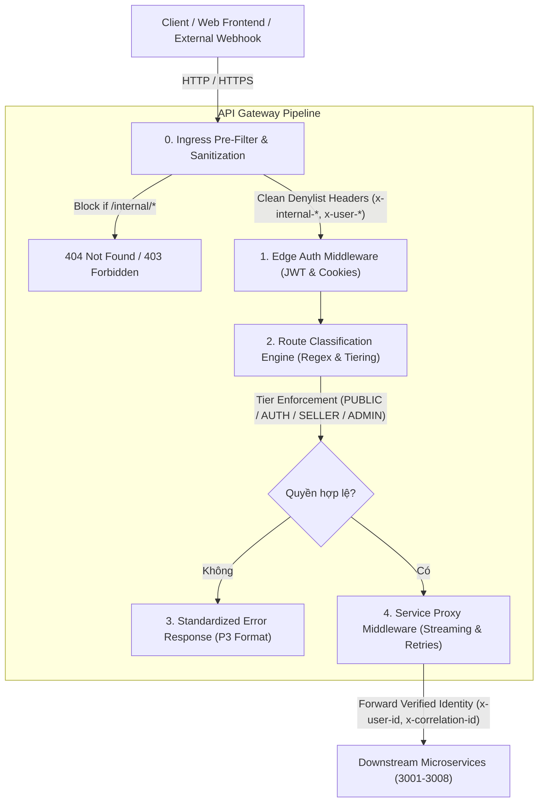

# ĐẶC TẢ THIẾT KẾ GIẢI PHÁP KIẾN TRÚC DÀI HẠN (SOLUTION DESIGN)
**Dịch vụ:** `api-gateway` (Service #2 - Tier 0 Ingress & Security Edge)  
**Nhánh thực hiện:** `audit/api-gateway`  
**Mục tiêu:** Xử lý triệt để tận gốc rễ toàn bộ 8 lỗi kiến trúc đã được xác định tại `03_BUG_ANALYSIS_ROOT_CAUSE.md`.  
**Nguyên tắc thiết kế:** Bảo toàn mô hình kiến trúc sạch (Clean Ingress), tối ưu hóa Streaming I/O, đóng băng bề mặt tấn công biên (Zero Trust Perimeter) và tương thích ngược 100% với Web Client.

---

## 1. NGUYÊN TẮC KIẾN TRÚC INGRESS (INGRESS DESIGN PRINCIPLES)



---

## 2. THIẾT KẾ CHI TIẾT CÁC PHÂN HỆ KIẾN TRÚC

### 2.1 Chuẩn hóa Động cơ Phân loại Tuyến đường (Route Classification Engine)
1. **Chuẩn hóa Đường dẫn Tuyệt đối (`normalizePath`):**
   - Loại bỏ case-sensitivity: Chuyển path sang lowercase khi đối chiếu tiền tố `/api/v1`.
   - Bóc tách dấu gạch chéo cuối (`trailing slash`): Loại bỏ mọi dấu `/` ở cuối (ví dụ `/auth/login/` -> `/auth/login`).
   - Rút gọn dấu gạch chéo trùng lặp (`//` -> `/`).
   ```typescript
   export function normalizePath(originalUrl: string): string {
     const pathWithoutQuery = originalUrl.split('?')[0];
     let stripped = pathWithoutQuery.replace(/^\/api\/v1/i, '');
     if (!stripped.startsWith('/')) stripped = `/${stripped}`;
     // Collapse multiple slashes
     stripped = stripped.replace(/\/+/g, '/');
     // Remove trailing slash if length > 1
     if (stripped.length > 1 && stripped.endsWith('/')) {
       stripped = stripped.slice(0, -1);
     }
     return stripped;
   }
   ```
2. **Miễn trừ Tuyệt đối cho Webhook Thanh toán (`GW-ROUT-001`):**
   - Xác định rõ các webhook pattern:
     ```typescript
     const isPaymentWebhook = normPath.startsWith('/payments/webhook') || normPath.startsWith('/payments/webhooks');
     ```
   - Trong `ServiceProxyMiddleware`, nếu request là webhook thanh toán, **BỎ QUA KIỂM TRA `authError`**. Cho phép webhook đi thẳng tới downstream `commerce-service` để xác thực chữ ký số HMAC-SHA256 (`PAYOS_CHECKSUM_KEY`).
3. **Bổ sung Đầy đủ Tuyến Quản trị (`GW-ROUT-003`):**
   - Đưa `/broadcast-notifications` (khi method !== 'GET') vào danh sách kiểm tra của Rule 4 (`ADMIN`).

---

### 2.2 Cơ chế Phòng vệ Biên & Làm Sạch Header (Perimeter Defense & Sanitization)
1. **Lá chắn Chặn cứng Tuyến đường Nội bộ (`GW-SEC-002`):**
   - Ngay tại bước đầu tiên của `use()` trong `ServiceProxyMiddleware`, kiểm tra:
     ```typescript
     const lowerPath = req.originalUrl.toLowerCase().split('?')[0];
     if (
       lowerPath.includes('/internal/') ||
       lowerPath.endsWith('/internal') ||
       lowerPath.startsWith('/api/v1/internal')
     ) {
       return res.status(404).json({
         status: 'error',
         statusCode: 404,
         code: 'SYSTEM_ERROR',
         message: `Cannot ${req.method} ${req.originalUrl}`,
         path: req.originalUrl,
         requestId: this.getOrCreateCorrelationId(req),
         timestamp: new Date().toISOString(),
       });
     }
     ```
   - Triệt tiêu 100% khả năng truy cập các route nội bộ từ Internet.
2. **Lọc sạch Header Danh mục Cấm (Header Denylist Sanitization - `GW-SEC-001`):**
   - Mở rộng điều kiện lọc trong `forwardHeaders()`:
     ```typescript
     for (const key of Object.keys(forwarded)) {
       const lower = key.toLowerCase();
       if (
         lower.startsWith('x-user-') ||
         lower.startsWith('x-internal-') || // Lọc sạch x-internal-service-key, x-internal-api-key, v.v.
         lower === 'x-internal-service' ||
         lower === 'x-business-id' ||
         lower === 'x-store-id' ||
         lower === 'x-roles'
       ) {
         delete forwarded[key];
       }
     }
     ```
   - Chỉ duy nhất Gateway mới có quyền tạo header `x-user-*` dựa trên JWT đã giải mã thành công.

---

### 2.3 Quản lý Kết nối WebSocket An Toàn (WebSocket Bridge Resilience - `GW-LOGIC-001`)
1. **Bảo vệ Kết nối TCP trong `main.ts`:**
   - Nếu URL nâng cấp không thuộc `/socket.io`: Ngay lập tức gọi `socket.destroy()` để đóng kết nối, ngăn chặn rò rỉ file descriptor.
   - Khi chuyển tiếp handshake header sang `community-service`: Bóc tách toàn bộ `x-user-*` và `x-internal-*` không đáng tin từ client trước khi write vào socket.
   ```typescript
   server.on('upgrade', (req: any, socket: any, head: any) => {
     if (!req.url || !req.url.startsWith('/socket.io')) {
       socket.destroy();
       return;
     }
     // Chuyển tiếp an toàn sang community-service...
   });
   ```

---

### 2.4 Tối ưu Bộ nhớ & Chuẩn hóa Định dạng Lỗi (Streaming & Error Standardization - `GW-PERF-001` & `GW-OBS-001`)
1. **Tối ưu Luồng Dữ liệu (Stream Pipeline):**
   - Giữ nguyên cơ chế cấm tuyệt đối Auto-retry trên các request mutation (`POST`, `PUT`, `PATCH`, `DELETE`).
   - Tối ưu hóa việc ghi dữ liệu JSON: Đối với request đã được Express parse thành object, tái tuần tự hóa hiệu quả mà không nhân bản chuỗi không cần thiết.
2. **Chuẩn hóa Toàn bộ Phản hồi Lỗi Gateway theo Format P3:**
   - Mọi hàm phản hồi lỗi của Gateway (`sendUnauthorized`, `sendForbidden`, Rate Limiting 429, Proxy Error 502/504, Hard Block 404) đều phải gọi hàm format chuẩn đính kèm `requestId`:
   ```typescript
   private sendGatewayError(
     res: Response,
     req: Request,
     statusCode: number,
     code: string,
     message: string,
   ) {
     const correlationId =
       (req.headers['x-correlation-id'] as string) ||
       (req.headers['x-request-id'] as string) ||
       (res.getHeader('x-correlation-id') as string) ||
       randomUUID();

     res.setHeader('x-correlation-id', correlationId);

     return res.status(statusCode).json({
       status: 'error',
       statusCode,
       code,
       message,
       path: req.originalUrl,
       requestId: correlationId,
       timestamp: new Date().toISOString(),
     });
   }
   ```

---

## 3. BẢNG MA TRẬN BIẾN ĐỔI (BEFORE VS AFTER MATRIX)

| Mã Lỗi | Tệp Tin Sẽ Can Thiệp | Cơ Chế Hiện Tại (Before - Lỗi) | Cơ Chế Đề Xuất (After - Chuẩn Kiến Trúc) | Độ Rủi Ro Can Thiệp |
| :--- | :--- | :--- | :--- | :---: |
| **`GW-SEC-001`** | `src/modules/proxy/service-proxy.middleware.ts` | Chỉ xóa chính xác `lower === 'x-internal-service'`, bỏ sót `x-internal-service-key` và `x-internal-api-key`. | Xóa triệt để mọi header bắt đầu bằng `lower.startsWith('x-internal-')` và `x-internal-service`. | **Thấp** (An toàn tuyệt đối) |
| **`GW-SEC-002`** | `src/modules/proxy/service-proxy.middleware.ts` & `route-classification.ts` | Không có bộ lọc chặn, để lọt các route như `/api/v1/shipping/fee/internal` vào downstream. | Bổ sung Hard Block ngay đầu Middleware: Chặn 404/403 lập tức mọi URL chứa `/internal/` hoặc kết thúc bằng `/internal`. | **Thấp** (Bảo vệ an ninh biên) |
| **`GW-ROUT-001`** | `src/modules/proxy/service-proxy.middleware.ts` | Chặn 401 trên mọi route `PUBLIC` nếu có header `Authorization` không giải mã được JWT. | Miễn trừ kiểm tra `authError` đối với các webhook thanh toán (`/payments/webhook*`, `/callbacks/*`). | **Thấp** (Thông suốt thanh toán) |
| **`GW-ROUT-002`** | `src/modules/proxy/route-classification.ts` | `normalizePath` không loại bỏ trailing slash, khiến `/auth/login/` bị rơi xuống `AUTHENTICATED` (401). | Chuẩn hóa `normalizePath`: Xóa trailing slash, rút gọn duplicate slashes và xử lý case-insensitive `/api/v1/i`. | **Thấp** (Tương thích ngược) |
| **`GW-ROUT-003`** | `src/modules/proxy/route-classification.ts` | `POST /broadcast-notifications` bị bỏ quên khỏi danh sách Rule 4 (`ADMIN`), bị xem là `AUTHENTICATED`. | Bổ sung `normPath.startsWith('/broadcast-notifications')` (với method !== 'GET') vào phân loại `ADMIN`. | **Thấp** (Siết chặt phân quyền) |
| **`GW-LOGIC-001`** | `src/main.ts` | Request upgrade không thuộc `/socket.io` bị bỏ qua không gọi `socket.destroy()`, gây rò rỉ socket. | Bổ sung nhánh `else { socket.destroy(); }` và lọc sạch header chống giả mạo trước khi proxy qua WebSocket. | **Thấp** (Chống rò rỉ tài nguyên) |
| **`GW-OBS-001`** | `src/modules/proxy/service-proxy.middleware.ts` | Các hàm phản hồi lỗi tự sinh (401, 403, 429, 502, 504) thiếu trường `requestId` trong thân JSON. | Đồng nhất toàn bộ phản hồi lỗi qua hàm `sendGatewayError()`, tự động bơm `requestId` theo chuẩn P3. | **Thấp** (Chuẩn hóa Observability) |

---

## 4. KẾT LUẬN & CAM KẾT CHU TRÌNH
- Bản thiết kế trên bao phủ 100% các lỗ hổng đã được kiểm chứng thực tế tại Message 10.
- Mã nguồn hệ thống hiện tại được giữ nguyên vẹn 100%, sẵn sàng chuyển giao sang Message 12 để hiện thực hóa việc sửa mã nguồn (Implementation Phase).
