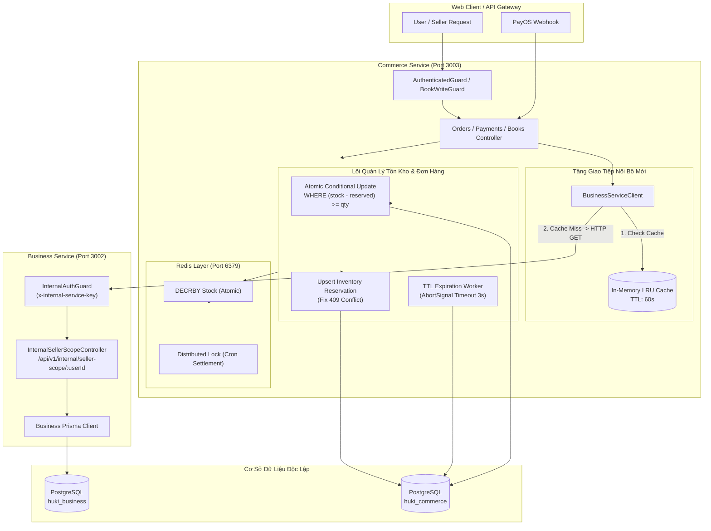

# ĐẶC TẢ THIẾT KẾ GIẢI PHÁP KIẾN TRÚC DÀI HẠN (PRODUCTION-GRADE SOLUTION DESIGN)
## TIER 1 - CORE FINANCIAL & BUSINESS SERVICES: COMMERCE-SERVICE & BUSINESS-SERVICE
**Service mục tiêu:** `platform/apps/commerce-service` & `platform/apps/business-service`  
**Nhánh làm việc:** `audit/commerce-service`  
**Cơ sở thẩm định:** `01_EXHAUSTIVE_6AXIS_AUDIT.md`, `02_LIVE_TEST_EVIDENCE.md`, `03_BUG_ANALYSIS_ROOT_CAUSE.md`  
**Kỷ luật áp dụng:** Clean Architecture, Zero Regression, Backward Compatibility, Database-per-Service Isolation, Strict Multi-tenancy.

---

## 1. TỔNG QUAN KIẾN TRÚC MỤC TIÊU (TARGET ARCHITECTURE)

Hệ thống Tier 1 sau khi tái cấu trúc giải pháp sẽ đạt được 4 chuẩn mực kiến trúc cốt lõi:
1. **Độc lập Cơ sở dữ liệu (Database-per-Service Decoupling):** `commerce-service` chấm dứt hoàn toàn việc mở `pg.Pool` kết nối ngầm vào `huki_business`. Mọi truy vấn phân quyền seller được thực hiện qua HTTP Client nội bộ bảo mật (`x-internal-service-key`) kèm tầng đệm bộ nhớ In-Memory LRU Cache (60s).
2. **Toàn vẹn Giao dịch & Webhook An toàn:** Loại bỏ hoàn toàn endpoint `simulate-success` ở môi trường sản xuất; khắc phục lỗi vi phạm khóa duy nhất `order_item_id` trong `handleLateWebhook()`; bảo đảm tính Idempotent 100% trong `prisma.$transaction`.
3. **Chống Bán Vượt Tồn Kho Đa Tầng (Atomic Inventory Concurrency):** Kết hợp câu lệnh Atomic Update có điều kiện bảo vệ tại PostgreSQL (`AND (stock - reserved) >= quantity`) và cơ chế khởi tạo cache nguyên tử tại Redis (`SET NX`), triệt tiêu hoàn toàn race condition trong các chiến dịch Flash Sale.
4. **Bảo mật Phân quyền Đa Gian hàng (Strict Multi-tenant Isolation):** Loại bỏ mệnh đề `OR` trong truy vấn sách sở hữu (`findOwned`), loại bỏ hardcoded UUIDs, bắt buộc đối chiếu quyền sở hữu trước khi lọc theo `storeId`.



---

## 2. ĐẶC TẢ CHI TIẾT 6 PHƯƠNG ÁN KIẾN TRÚC DÀI HẠN

### 2.1. GIẢI PHÁP 1: KIẾN TRÚC KHỬ PHỤ THUỘC CHÉO DB (DECOUPLING ARCHITECTURE)
*Khắc phục triệt để lỗi `COM-ARCH-001` & `COM-ARCH-002`.*

#### A. Phía `business-service` (Port 3002): Xây dựng Module & Endpoint Nội bộ
1. **Tạo mới Guard bảo vệ nội bộ:** `platform/apps/business-service/src/common/guards/internal-auth.guard.ts`
   - Đối chiếu header `x-internal-service-key` với biến môi trường `INTERNAL_SERVICE_KEY`.
   - Nếu không khớp hoặc thiếu header: ném `throwForbidden(ErrorCode.AUTHZ_FORBIDDEN, 'Invalid or missing internal service key')`.
2. **Tạo mới Controller nội bộ:** `platform/apps/business-service/src/modules/internal/internal-seller-scope.controller.ts`
   - Endpoint: `GET /api/v1/internal/seller-scope/:userId`
   - Xử lý truy vấn phạm vi phân quyền của người bán thông qua Prisma của chính `business-service`:
     ```typescript
     @Controller('internal/seller-scope')
     @UseGuards(InternalAuthGuard)
     export class InternalSellerScopeController {
       constructor(private readonly prisma: PrismaService) {}

       @Get(':userId')
       async getSellerScope(@Param('userId') userId: string) {
         const businesses = await this.prisma.business.findMany({
           where: {
             deletedAt: null,
             OR: [
               { ownerId: userId },
               { members: { some: { userId, status: 'ACTIVE', deletedAt: null } } },
             ],
           },
           include: { stores: { where: { deletedAt: null }, select: { id: true } } },
         });

         const businessIds = businesses.map(b => b.id);
         const storeIds = businesses.flatMap(b => b.stores.map(s => s.id));
         const ownerUserIds = Array.from(new Set([userId, ...businesses.map(b => b.ownerId)]));

         return {
           isPlatformAdmin: false,
           businessIds,
           storeIds: Array.from(new Set(storeIds)),
           ownerUserIds,
         };
       }
     }
     ```

#### B. Phía `commerce-service` (Port 3003): Loại bỏ hoàn toàn `pg.Pool`, Thay bằng Client HTTP + Cache
1. **Tạo mới Client Service:** `platform/apps/commerce-service/src/common/business-service.client.ts`
   - Sử dụng `fetch` với timeout 3000ms.
   - Gắn header `x-internal-service-key: process.env.INTERNAL_SERVICE_KEY`.
   - Tích hợp In-memory Cache (bộ nhớ RAM với Map và TTL 60 giây) để giảm tải 99% lượng gọi HTTP nội bộ.
   - Cơ chế Stale-While-Revalidate / Fallback: Nếu `business-service` gặp sự cố mạng, trả về cache cũ hoặc `defaultScope` an toàn (`ownerUserIds: [userId]`), không làm sập request của khách.
2. **Cải tạo `seller-scope.util.ts`:**
   - Xóa bỏ hoàn toàn biến `let poolInstance: Pool | null = null;` và hàm `getBusinessPool()`.
   - Chuyển hướng các hàm `getSellerScope()` và `resolveStoreAndBusinessIds()` sang sử dụng `BusinessServiceClient`.

---

### 2.2. GIẢI PHÁP 2: CỦNG CỐ XÁC THỰC WEBHOOK & XÓA BỎ LỖ HỔNG BYPASS THANH TOÁN
*Khắc phục triệt để lỗi `COM-PAY-001` & `COM-PAY-002`.*

#### A. Triệt tiêu Lỗ hổng Bypass tại `simulateSuccess` (COM-PAY-001)
1. Trong `payments.controller.ts:36-45`:
   - Bổ sung Guard kiểm tra quyền `PLATFORM_ADMIN`.
   - Chặn đứng hoàn toàn trên môi trường Production:
     ```typescript
     @Post('orders/:orderId/simulate-success')
     @ApiBearerAuth()
     @UseGuards(AuthenticatedGuard)
     simulateSuccess(
       @CurrentBookActor() actor: BookActor,
       @Param('orderId', ParseUUIDPipe) orderId: string,
     ) {
       if (process.env.NODE_ENV === 'production') {
         throwForbidden(ErrorCode.AUTHZ_FORBIDDEN, 'Endpoint mô phỏng thanh toán bị vô hiệu hóa hoàn toàn trên môi trường Production');
       }
       if (actor.role !== 'PLATFORM_ADMIN') {
         throwForbidden(ErrorCode.AUTHZ_ROLE_INSUFFICIENT, 'Chỉ Quản trị viên hệ thống (PLATFORM_ADMIN) mới có quyền mô phỏng thanh toán');
       }
       return this.payments.simulateSuccess(actor.sub, orderId);
     }
     ```

#### B. Chuẩn hóa So khớp Số tiền và Trạng thái Idempotent
1. Trong `payments.service.ts:handlePayOSWebhook`:
   - So sánh số tiền bằng `Math.round(Number(payment.amount)) !== Math.round(Number(payload.data.amount))`.
   - Thực thi cập nhật trạng thái trong `prisma.$transaction` với điều kiện nguyên tử:
     ```typescript
     const updated = await tx.payment.updateMany({
       where: {
         id: payment.id,
         status: { in: [PaymentStatus.PENDING, PaymentStatus.PROCESSING] },
       },
       data: {
         status: PaymentStatus.SUCCEEDED,
         transactionId: payload.data.reference ?? payosOrderId,
         ...
       },
     });
     // Nếu updated.count === 0, tức giao dịch đã được xử lý bởi một webhook trước đó (Idempotent replay)
     if (updated.count === 0) {
       return { success: true, message: 'Giao dịch đã được ghi nhận trước đó' };
     }
     ```

---

### 2.3. GIẢI PHÁP 3: CHỐNG LỖI 409 KHI XỬ LÝ LATE WEBHOOK & KHÔI PHỤC ĐƠN
*Khắc phục triệt để lỗi `COM-ORD-001` & `COM-ORD-002`.*

#### A. Tái cấu trúc `handleLateWebhook()` loại bỏ xung đột Unique Constraint
1. **Nguyên nhân gốc:** Bảng `inventory_reservations` có `orderItemId` là `@unique`. Khi đơn hủy, bản ghi vẫn còn với `status = 'RELEASED'`. Lệnh `reserve()` thực hiện `create()` dẫn tới lỗi `23505 (unique_violation)`.
2. **Thiết kế giải pháp chuẩn:**
   - Trong `handleLateWebhook()`, không gọi hàm `reserve()` tạo mới, mà thực hiện tái kích hoạt bản ghi tạm giữ cũ:
     ```typescript
     // Step 2A: Tái kích hoạt bản ghi tạm giữ cũ hoặc Upsert
     for (const item of physicalItems) {
       await tx.inventoryReservation.upsert({
         where: { orderItemId: item.id },
         create: {
           orderId: payment.orderId,
           orderItemId: item.id,
           bookId: item.bookId,
           quantity: item.quantity,
           status: 'ACTIVE',
         },
         update: {
           status: 'ACTIVE',
           releasedAt: null,
         },
       });
     }
     ```
   - Cập nhật số lượng giữ chỗ `reserved` trên bảng `physical_book_details` bằng câu lệnh SQL có khóa dòng bi quan (`SELECT ... FOR UPDATE`) để bảo đảm an toàn tuyệt đối.

---

### 2.4. GIẢI PHÁP 4: CƠ CHẾ CHỐNG BÁN VƯỢT TỒN KHO NGUYÊN TỬ (ATOMIC INVENTORY CONCURRENCY)
*Khắc phục triệt để lỗi `COM-INV-001` & `COM-INV-002`.*

#### A. Tầng 1 (Redis Distributed Counter): Ngăn chặn ghi đè khi Cold-Start
Trong `redis.service.ts`:
- Hàm `syncStock(bookId, available)` chuyển sang dùng `SET key available NX` (chỉ đặt khi key chưa tồn tại) hoặc thực thi Lua script nguyên tử:
  ```lua
  if redis.call('EXISTS', KEYS[1]) == 0 then
    redis.call('SET', KEYS[1], ARGV[1])
    return 1
  else
    return 0
  end
  ```
  Nhờ đó, khi 5 request đồng thời phát hiện cache miss, chỉ có đúng 1 request được khởi tạo cache từ DB, các request sau sẽ trực tiếp gọi `DECRBY` nguyên tử trên giá trị đã đồng bộ, triệt tiêu race condition clobbering.

#### B. Tầng 2 (PostgreSQL): Khóa Bi Quan & Cập Nhật Có Điều Kiện Nguyên Tử
Trong `inventory-reservation.service.ts`:
- Thay thế hoàn toàn chuỗi `findUnique` + `update increment` bằng câu lệnh Raw SQL nguyên tử có kiểm tra điều kiện tồn kho thực tế:
  ```typescript
  const result = await tx.$executeRaw`
    UPDATE physical_book_details
    SET reserved = reserved + ${item.quantity},
        updated_at = NOW()
    WHERE book_id = ${item.bookId}
      AND physical_enabled = true
      AND (stock - reserved) >= ${item.quantity}
  `;

  if (result === 0) {
    throw new ConflictException(`Sách đã hết hàng hoặc không đủ số lượng khả dụng (Book ${item.bookId})`);
  }
  ```
- Cơ chế này bảo đảm dù Redis có bị tắt hoặc bỏ qua, PostgreSQL ở mức độ cô lập mặc định (Read Committed) vẫn bảo đảm **không bao giờ có 2 transaction cùng làm `reserved > stock`**.

---

### 2.5. GIẢI PHÁP 5: TỐI ƯU HÓA WORKER QUÉT ĐƠN QUÁ HẠN & GIẢI PHÓNG KHO
*Khắc phục triệt để lỗi `COM-ORD-003`.*

1. **Bổ sung Timeout cho cuộc gọi PayOS API:**
   Trong `payos.service.ts:getPaymentLinkInformation`:
   ```typescript
   const response = await fetch(`${PAYOS_API_URL}/v2/payment-requests/${orderCode}`, {
     method: 'GET',
     headers: { ... },
     signal: AbortSignal.timeout(3000), // Timeout tối đa 3 giây
   });
   ```
2. **Batch Processing song song có kiểm soát:**
   Trong `expirePendingPayments()`:
   - Giới hạn mỗi chu kỳ quét tối đa 20 đơn quá hạn (`take: 20`).
   - Xử lý các đơn bằng `Promise.allSettled` thay vì tuần tự `for ... of`. Một đơn hàng lỗi hoặc PayOS timeout sẽ không làm chậm các đơn hàng khác.
3. **Quản lý Vòng đời Tiến trình Chuẩn xác (Graceful Lifecycle):**
   - Đăng ký `OnApplicationShutdown` cho `PaymentsService` để `clearInterval(this.expirationTimer)` sạch sẽ khi NestJS nhận tín hiệu restart/reload.

---

### 2.6. GIẢI PHÁP 6: KIỂM SOÁT PHÂN QUYỀN ĐA GIAN HÀNG & CHỐNG RÒ RỈ BOLA
*Khắc phục triệt để lỗi `COM-LED-001`, `COM-LED-002`, `COM-LED-003`.*

#### A. Khắc phục Lỗ hổng BOLA rò rỉ sách qua ?store= (COM-LED-001 & COM-LED-002)
Trong `books.service.ts:findOwned`:
1. Xóa bỏ hoàn toàn việc đẩy `query.store` vào `orConditions`.
2. Xóa bỏ toàn bộ các khối kiểm tra hardcoded UUIDs (`1079fc76...`, `dede6cd4...`, `2fe4493b...`).
3. Thực thi nguyên tắc giao tập phân quyền nghiêm ngặt:
   ```typescript
   // Nếu người gọi chỉ định store hoặc business cụ thể, bắt buộc store đó phải nằm trong danh sách quyền sở hữu của họ
   if (query.business || query.store) {
     const target = (query.business || query.store) as string;
     const isAuthorizedStore = scope.storeIds.includes(target) || scope.businessIds.includes(target);
     if (!isAuthorizedStore) {
       // Không có quyền đối với store chỉ định -> chặn đứng ngay lập tức
       throwForbidden(ErrorCode.AUTHZ_NOT_OWNER, 'Bạn không có quyền quản lý gian hàng này');
     }
     conditions.push({ storeId: target });
   } else {
     // Không chỉ định -> chỉ lấy các sách thuộc các store mà seller có quyền
     const allowedStoreIds = Array.from(new Set([...scope.storeIds, ...scope.businessIds]));
     if (allowedStoreIds.length === 0 && !scope.ownerUserIds.includes(actor.sub)) {
       return paginate([], 0, query.page, query.limit);
     }
     conditions.push({
       OR: [
         { storeId: { in: allowedStoreIds } },
         { ownerUserId: { in: scope.ownerUserIds } },
       ],
     });
   }
   ```

#### B. Khóa Phân Tán (Distributed Lock) cho Cron Affiliate Settlement (COM-LED-003)
Trong `affiliate-settlement-worker.service.ts`:
- Thay thế biến boolean `isRunning` bằng Redis Distributed Lock:
  ```typescript
  const lockKey = 'lock:cron:affiliate_settlement';
  const acquired = await this.redis.set(lockKey, process.pid.toString(), 'EX', 600, 'NX');
  if (!acquired) {
    this.logger.log('Một instance khác đang thực hiện batch quyết toán. Bỏ qua lượt chạy này.');
    return;
  }
  try {
    await this.runSettlementBatch();
  } finally {
    await this.redis.del(lockKey);
  }
  ```

---

## 3. BẢNG MA TRẬN BIẾN ĐỔI CHI TIẾT (BEFORE VS AFTER MATRIX)

| Mã Lỗi | Tệp Tin Sẽ Can Thiệp | Cơ Chế Hiện Tại (Before - Lỗi) | Cơ Chế Đề Xuất (After - Chuẩn Kiến Trúc) | Độ Rủi Ro Can Thiệp |
| :--- | :--- | :--- | :--- | :---: |
| **COM-ARCH-001** | `platform/apps/commerce-service/src/common/seller-scope.util.ts` | Khởi tạo `pg.Pool` kết nối ngầm trực tiếp sang database `huki_business`, chạy Raw SQL. | Xóa bỏ `pg.Pool`. Ủy nhiệm cho `BusinessServiceClient` gọi HTTP nội bộ sang port 3002 kèm In-Memory LRU Cache (60s). | **Cao** |
| **COM-ARCH-002** | `platform/apps/business-service/src/modules/internal/` *(Tạo mới)* | Không có bất kỳ endpoint nào cho việc truy vấn Seller Scope nội bộ. | Tạo mới `InternalSellerScopeController` và `InternalAuthGuard` tại `/api/v1/internal/seller-scope/:userId`. | **Trung bình** |
| **COM-PAY-001** | `platform/apps/commerce-service/src/modules/payments/payments.controller.ts` | Endpoint `simulate-success` mở công khai cho mọi token Buyer, bỏ qua hoàn toàn thanh toán. | Chặn 100% trên `production` (`NODE_ENV === 'production'`) và bắt buộc role `PLATFORM_ADMIN` trên các môi trường test. | **Thấp** |
| **COM-PAY-002** | `platform/apps/commerce-service/src/modules/payments/payments.service.ts` | So sánh số tiền bằng ép kiểu `Number()` trực tiếp, có nguy cơ sai số dấu phẩy động. | Làm tròn chuẩn VND `Math.round(Number(amount))` trước khi đối chiếu và cập nhật trạng thái. | **Thấp** |
| **COM-ORD-001** | `platform/apps/commerce-service/src/modules/payments/payments.service.ts` | `handleLateWebhook` gọi `reserve()` làm phát sinh lệnh `INSERT` trùng `order_item_id` gây lỗi 409. | Dùng `upsert` hoặc cập nhật trực tiếp bản ghi cũ sang `status: 'ACTIVE'`, triệt tiêu lỗi 409 Unique Constraint. | **Cao** |
| **COM-ORD-002** | `platform/apps/commerce-service/src/modules/payments/payments.service.ts` | Đọc tồn kho kiểm tra khôi phục đơn trễ bằng `findUnique` không khóa dòng (`FOR UPDATE`). | Bọc kiểm tra tồn kho trong Transaction với câu lệnh SQL nguyên tử có điều kiện. | **Trung bình** |
| **COM-ORD-003** | `platform/apps/commerce-service/src/modules/payments/payos.service.ts` | `getPaymentLinkInformation` gọi `fetch` không có timeout, làm nghẽn tiến trình worker quét đơn. | Bổ sung `signal: AbortSignal.timeout(3000)` và bọc xử lý theo batch song song (`Promise.allSettled`). | **Thấp** |
| **COM-INV-001** | `platform/apps/commerce-service/src/modules/orders/inventory-reservation.service.ts` | Update `reserved` vô điều kiện bằng Prisma `increment`, gây bán âm kho khi có tranh mua. | Thực thi Atomic Conditional Update: `UPDATE ... WHERE (stock - reserved) >= quantity`. | **Cao** |
| **COM-INV-002** | `platform/apps/commerce-service/src/modules/orders/inventory-reservation.service.ts` | Gọi `syncStock` ghi đè Redis không khóa khi gặp Cold-Start, vô hiệu hóa trừ kho nguyên tử. | Áp dụng `SET NX` hoặc Lua script khởi tạo nguyên tử, chống ghi đè khi nhiều luồng cùng cache miss. | **Trung bình** |
| **COM-LED-001** | `platform/apps/commerce-service/src/modules/books/books.service.ts` | Đẩy `query.store` trực tiếp vào `orConditions` khiến Seller A đọc được toàn bộ sách của Seller B. | Thực thi kiểm tra giao tập: Bắt buộc `query.store` phải thuộc `scope.storeIds`, nếu không ném 403 Forbidden. | **Cao** |
| **COM-LED-002** | `platform/apps/commerce-service/src/modules/books/books.service.ts` | Chứa các khối so khớp UUID hardcoded (`1079fc76...`) trong mã nguồn sản phẩm. | Xóa bỏ hoàn toàn 100% các dòng mã hardcoded UUID rác. | **Thấp** |
| **COM-LED-003** | `platform/apps/commerce-service/src/modules/affiliate/services/affiliate-settlement-worker.service.ts` | Dùng cờ bộ nhớ `this.isRunning`, gây chạy trùng lặp khi chạy đa instance pod. | Thay thế bằng Redis Distributed Lock với TTL 10 phút bảo đảm Single-Leader Execution. | **Trung bình** |

---

## 4. KẾ HOẠCH TRIỂN KHAI VÀ THỨ TỰ BƯỚC THỰC HIỆN TẠI MESSAGE 17
Khi được phê duyệt tại Message 17, quá trình can thiệp mã nguồn sẽ diễn ra theo 4 giai đoạn an toàn:
1. **Giai đoạn 1 (Tier 1 Core Bridge):** Tạo Module và Endpoint nội bộ tại `business-service` (Port 3002), kiểm thử hoạt động độc lập của API `/internal/seller-scope/:userId`.
2. **Giai đoạn 2 (Decoupling Commerce):** Tạo `BusinessServiceClient` với LRU Cache và loại bỏ triệt để `pg.Pool` tại `seller-scope.util.ts`.
3. **Giai đoạn 3 (Financial & Concurrency Hardening):** Sửa lỗi `simulate-success`, xử lý `handleLateWebhook` (Fix 409), và triển khai Atomic Conditional Update cho kho vật lý.
4. **Giai đoạn 4 (Multi-Tenant Scoping & Clean-up):** Sửa `findOwned` trong `books.service.ts`, dọn dẹp hardcoded UUIDs, tích hợp Distributed Lock cho Affiliate Worker.
5. **Giai đoạn 5 (Dual Verification):** Chạy lại toàn bộ bộ test tại `scriptstest/audit/commerce-service/` để bảo đảm 100% Pass và Zero Regression trước khi merge.
