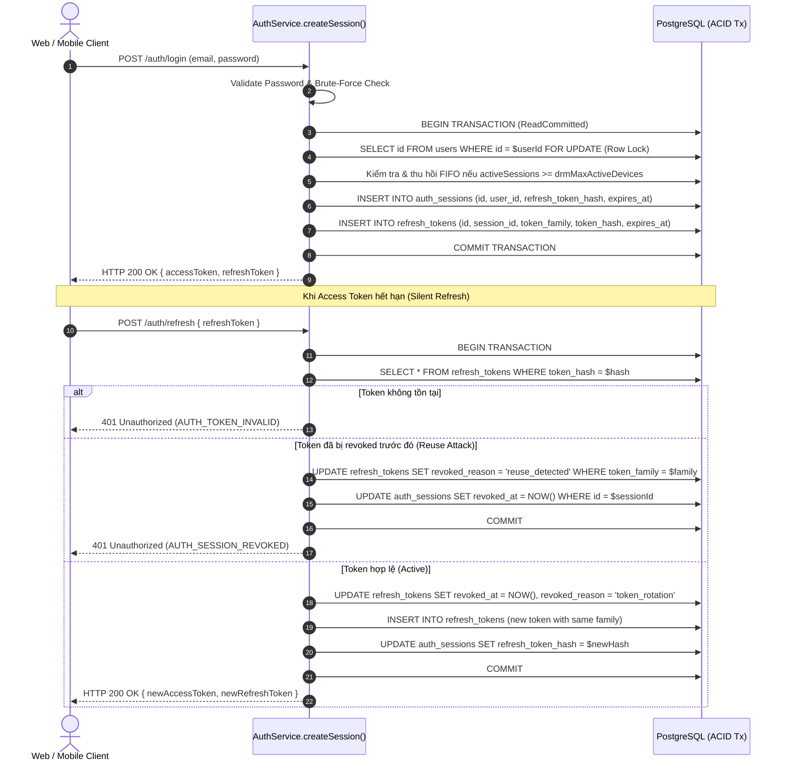

# BẢN THIẾT KẾ GIẢI PHÁP KIẾN TRÚC DÀI HẠN (SOLUTION DESIGN)
## SERVICE #1: IDENTITY-SERVICE (`platform/apps/identity-service`)

> **Ngày thực hiện:** 06/11/2026  
> **Nhánh Git:** `audit/identity-service`  
> **Tài liệu căn cứ:** `docs/audit/identity-service/03_BUG_ANALYSIS_ROOT_CAUSE.md`  
> **Mục tiêu:** Đặc tả kiến trúc kỹ thuật chuẩn Clean Architecture, bảo đảm tính toàn vẹn dữ liệu (ACID / Idempotency), bảo mật Zero-Trust và khả năng mở rộng trong tương lai.  
> **Kỷ luật:** Đây là tài liệu thiết kế thẩm định; TUYỆT ĐỐI CHƯA CHỈNH SỬA CODE cho tới khi được Master Architect phê duyệt qua Message 7.

---

## 1. KIẾN TRÚC LUỒNG XỬ LÝ MỤC TIÊU (TARGET ARCHITECTURE FLOWS)

### 1.1. Luồng Xác Thực Google OAuth2 Nghiêm Ngặt (`ID-SEC-001`)

**Vấn đề cũ:** Tin cậy trường `email` gửi lên từ Client body; nếu không gửi kèm `accessToken`/`idToken` thì hệ thống tự động cấp token cho email đó.

**Luồng mới (Strict Token-First Verification):**
```
Client (Web/Mobile)            Identity-Service API              Google OAuth2 API / SDK              PostgreSQL DB
       |                                |                                   |                               |
       |--- POST /auth/google --------->|                                   |                               |
       |    { idToken || accessToken }  |                                   |                               |
       |    (CẤM gửi trường email)      |                                   |                               |
       |                                |-- 1. Validate: Có idToken/Token?--|                               |
       |                                |      (Nếu KHÔNG -> Báo 400 BadReq)|                               |
       |                                |                                   |                               |
       |                                |-- 2. Verify with Google --------->|                               |
       |                                |      (Verify ID Token / UserInfo) |                               |
       |                                |<-- 3. Trả về Verified Profile ----|                               |
       |                                |      { email, name, picture }     |                               |
       |                                |                                   |                               |
       |                                |-- 4. Tìm kiếm User theo verified email -------------------------->|
       |                                |      (Nếu chưa có -> Tạo mới User với email_verified = true)      |
       |                                |<-- 5. User Entity ------------------------------------------------|
       |                                |                                   |                               |
       |                                |-- 6. Tạo Session & Token Family (Atomic Transaction) ------------>|
       |                                |<-- 7. Cấp Access Token & Refresh Token ---------------------------|
       |<-- HTTP 200 OK (Tokens) -------|                                   |                               |
```

- **Quy tắc bất biến:** `email` của người dùng **BẮT BUỘC PHẢI ĐƯỢC TRÍCH XUẤT TRỰC TIẾP TỪ KẾT QUẢ XÁC THỰC CỦA GOOGLE API / GOOGLE OAUTH2 CLIENT**. Tuyệt đối không đọc trường `email` từ HTTP Request Body.

---

### 1.2. Luồng Khởi Tạo & Xoay Vòng Refresh Token Nguyên Khối (`ID-BIZ-001` & `ID-BIZ-004`)

**Vấn đề cũ:** `createSession` chỉ ghi vào bảng `auth_sessions`, bỏ quên bảng `refresh_tokens`. Lần refresh đầu tiên lập tức gãy với mã `401 AUTH_TOKEN_EXPIRED`.

**Luồng mới (Atomic Session & RefreshToken Creation):**



---

### 1.3. Luồng Transactional Outbox Chuẩn ACID (`ID-BIZ-002`)

**Vấn đề cũ:** `auth.service.ts` bắn sự kiện vào in-memory `EventEmitter2`, không ai lưu vào bảng `outbox_events`. RabbitMQ Publisher chạy không tải.

**Luồng mới (In-Transaction Outbox Persistence):**
```
Client                      AuthService                        PostgreSQL (Transaction)               Outbox Publisher        RabbitMQ (huki.events)
  |                              |                                        |                                  |                           |
  |--- POST /auth/register ----->|                                        |                                  |                           |
  |                              |-- 1. BEGIN Tx ------------------------>|                                  |                           |
  |                              |-- 2. INSERT INTO users --------------->|                                  |                           |
  |                              |-- 3. INSERT INTO outbox_events ------->|                                  |                           |
  |                              |      { type: 'identity.user.registered'|                                  |                           |
  |                              |        aggregateId: user.id,           |                                  |                           |
  |                              |        payload: {...}, status: 'PENDING'}                                 |                           |
  |                              |-- 4. COMMIT Tx ----------------------->|                                  |                           |
  |<-- HTTP 201 Created ---------|                                        |                                  |                           |
                                                                          |                                  |                           |
                                                                          |<-- 5. Poll 'PENDING' (FOR UPDATE)|                           |
                                                                          |-- 6. Claim: status='PROCESSING'->|                           |
                                                                          |                                  |-- 7. Publish Event ------>|
                                                                          |                                  |      (Topic: user.registered)
                                                                          |<-- 8. status='PUBLISHED' --------|                           |
```

- **Quy tắc bất biến:** Bản ghi thay đổi của `users` và bản ghi sự kiện `outbox_events` **PHẢI ĐƯỢC THỰC THI TRONG CÙNG MỘT PRISMA TRANSACTION**. Nếu ghi outbox thất bại, nghiệp vụ tạo user phải rollback hoàn toàn.

---

### 1.4. Loại Bỏ Truy Vấn Cross-Database Bằng Event-Driven Synchronization (`ID-PERF-001`)

**Vấn đề cũ:** `identity-service` khởi tạo raw `new Client()` kết nối trực tiếp vào DB của `business-service` và `commerce-service` trên mỗi lượt login/refresh.

**Kiến trúc mới (Decoupled Event-Driven Role Sync):**
1. **Loại bỏ hàm `ensureBusinessRoleIfApproved()`:** Khi người dùng được duyệt trở thành Business Owner tại `business-service`, `business-service` bắn sự kiện RabbitMQ: `business.store.approved` với payload `{ ownerId: "..." }`.
2. `identity-service` có một Consumer lắng nghe event `business.store.approved` và cập nhật trường `role: 'BUSINESS'` trực tiếp vào bảng `users` nội bộ của nó.
3. Trong các truy vấn Admin (`getAllUsersForAdmin`), thay vì truy vấn trực tiếp DB ngoại vi, `identity-service` chỉ trả về thông tin User thuộc quyền quản lý của nó. Việc ghép nối tên Store/Gian hàng do API Gateway Ingress hoặc GraphQL/BFF tổng hợp (API Composition Pattern).
4. Khối query kiểm tra đơn hàng đang hoạt động trước khi xóa tài khoản (`checkActiveOrders`): Thay thế bằng một cuộc gọi HTTP/gRPC nội bộ: `GET http://commerce-service:3003/internal/orders/active-count?userId=...` với timeout 2000ms.

---

### 1.5. Vòng Đời Xóa Tài Khoản & Worker Định Kỳ (`ID-BIZ-003`)

**Thiết kế mới (Account Purge Cron Worker):**
1. Thêm Cron Job `@Cron(CronExpression.EVERY_HOUR)` tại `UserPurgeCron`:
2. Tìm tất cả người dùng có `status = 'PENDING_DELETION'` và `deletionScheduledAt <= new Date()`.
3. Với từng người dùng quá hạn 7 ngày:
   - Thu hồi toàn bộ session và token.
   - Ẩn danh hóa dữ liệu (Anonymization): `email = deleted_<uuid>@anonymized.huki.vn`, `phone = null`, `fullName = 'Người dùng đã xóa'`, `avatar = null`.
   - Cập nhật `status = 'DELETED'`, `deletedAt = new Date()`.
   - Ghi bản ghi vào `outbox_events` (`identity.user.deleted`) để thông báo cho toàn hệ thống dọn dẹp giỏ hàng, wishlist.
   - Ghi vết vào `audit_logs` với action `PURGE_COMPLETED`.

---

## 2. THIẾT KẾ THAY ĐỔI SCHEMA & CƠ SỞ DỮ LIỆU (DATABASE & INDEXES)

Cập nhật file [platform/apps/identity-service/prisma/schema.prisma](file:///platform/apps/identity-service/prisma/schema.prisma):

```prisma
// ============================================
// MODEL: USER
// ============================================
model User {
  id                         String    @id @default(uuid())
  email                      String    @unique
  passwordHash               String    @map("password_hash")
  fullName                   String    @map("full_name")
  phone                      String?
  avatar                     String?
  role                       UserRole  @default(USER)
  status                     UserStatus @default(ACTIVE)

  emailVerifiedAt            DateTime? @map("email_verified_at")
  emailVerificationToken     String?   @map("email_verification_token")
  emailVerificationExpiresAt DateTime? @map("email_verification_expires_at")

  passwordResetToken         String?   @map("password_reset_token")
  passwordResetExpiresAt     DateTime? @map("password_reset_expires_at")

  failedLoginAttempts        Int       @default(0) @map("failed_login_attempts")
  lockedUntil                DateTime? @map("locked_until")
  mustChangePassword         Boolean   @default(false) @map("must_change_password")

  hasCompletedOnboarding     Boolean   @default(false) @map("has_completed_onboarding")
  onboardingPreferences      Json?     @map("onboarding_preferences")

  sessions                   AuthSession[]

  createdAt                  DateTime  @default(now()) @map("created_at")
  updatedAt                  DateTime  @updatedAt @map("updated_at")
  deletedAt                  DateTime? @map("deleted_at")

  deletionRequestedAt        DateTime? @map("deletion_requested_at")
  deletionScheduledAt        DateTime? @map("deletion_scheduled_at")
  deletionOtp                String?   @map("deletion_otp")
  deletionOtpExpiresAt       DateTime? @map("deletion_otp_expires_at")
  deletionCount              Int       @default(0) @map("deletion_count")
  originalEmail              String?   @map("original_email")

  // INDEXES MỚI BỔ SUNG ĐỂ TỐI ƯU HIỆU NĂNG & WORKER QUÉT
  @@index([email])
  @@index([role])
  @@index([status])
  @@index([emailVerificationToken])               // [MỚI] Tối ưu xác thực OTP (ID-PERF-002)
  @@index([passwordResetToken])                   // [MỚI] Tối ưu quên mật khẩu (ID-PERF-002)
  @@index([status, deletionScheduledAt])          // [MỚI] Tối ưu Cron Job quét xóa tài khoản (ID-BIZ-003)
  @@map("users")
}

// ============================================
// MODEL: AUTH SESSION
// ============================================
model AuthSession {
  id               String    @id @default(uuid())
  userId           String    @map("user_id")
  refreshTokenHash String    @map("refresh_token_hash")
  userAgent        String?
  ipAddress        String?   @map("ip_address")
  deviceType       String?   @map("device_type")
  deviceName       String?   @map("device_name")
  location         String?
  expiresAt        DateTime  @map("expires_at")
  lastActiveAt     DateTime? @map("last_active_at")
  revokedAt        DateTime? @map("revoked_at")

  user             User           @relation(fields: [userId], references: [id], onDelete: Cascade)
  refreshTokens    RefreshToken[]

  createdAt        DateTime @default(now()) @map("created_at")
  updatedAt        DateTime @updatedAt @map("updated_at")

  // INDEXES MỚI BỔ SUNG
  @@index([userId, revokedAt])
  @@index([refreshTokenHash, revokedAt])          // [MỚI] Tối ưu Logout & Session Lookup (ID-PERF-002)
  @@map("auth_sessions")
}
```

---

## 3. THIẾT KẾ INTERFACES, DTOS & VALIDATION CHUẨN MỰC

### 3.1. DTO Đồng Bộ Độ Phức Tạp Mật Khẩu (`ID-UI-002`)
Tạo hằng số regex dùng chung tại `@huki/shared` hoặc `auth/constants.ts`:
```typescript
export const PASSWORD_REGEX = /^(?=.*[a-z])(?=.*[A-Z])(?=.*\d)(?=.*[@$!%*?&])[A-Za-z\d@$!%*?&]{8,}$/;
export const PASSWORD_MESSAGE = 'Password must be at least 8 characters, containing uppercase, lowercase, number, and special character (@$!%*?&)';
```
Đồng bộ áp dụng cho:
- `RegisterDto` ([register.dto.ts](file:///platform/apps/identity-service/src/modules/auth/dto/register.dto.ts))
- `ResetPasswordDto` ([password.dto.ts](file:///platform/apps/identity-service/src/modules/auth/dto/password.dto.ts))
- `ChangePasswordDto` ([password.dto.ts](file:///platform/apps/identity-service/src/modules/auth/dto/password.dto.ts))

### 3.2. DTO Đăng Nhập Google Nghiêm Ngặt (`ID-SEC-001`)
Cập nhật [google-login.dto.ts](file:///platform/apps/identity-service/src/modules/auth/dto/google-login.dto.ts):
```typescript
export class GoogleLoginDto {
  @ApiPropertyOptional({ description: 'Google ID Token from Google Identity Services' })
  @IsOptional()
  @IsString()
  idToken?: string;

  @ApiPropertyOptional({ description: 'Google OAuth2 Access Token' })
  @IsOptional()
  @IsString()
  accessToken?: string;

  // TUYỆT ĐỐI KHÔNG CÓ TRƯỜNG email TRONG DTO NÀY!
}
```

### 3.3. Bảo Vệ Toàn Diện 6 Admin Endpoints Trong `user.controller.ts` (`ID-SEC-003`)
Bổ sung Guard và Role check trên toàn bộ các endpoint quản trị:
```typescript
@UseGuards(JwtAuthGuard, RolesGuard)
@Roles('PLATFORM_ADMIN')
@Post('admin/:id/restore')
async restoreUserByAdmin(@Param('id') id: string) { ... }

@UseGuards(JwtAuthGuard, RolesGuard)
@Roles('PLATFORM_ADMIN')
@Get('admin/all')
async getAllUsersForAdmin(...) { ... }

@UseGuards(JwtAuthGuard, RolesGuard)
@Roles('PLATFORM_ADMIN')
@Post('admin/customer')
async createCustomerByAdmin(...) { ... }

@UseGuards(JwtAuthGuard, RolesGuard)
@Roles('PLATFORM_ADMIN')
@Patch('admin/:id')
async updateUserByAdmin(...) { ... }

@UseGuards(JwtAuthGuard, RolesGuard)
@Roles('PLATFORM_ADMIN')
@Post('admin/:id/toggle-lock')
async toggleLockByAdmin(@Param('id') id: string) { ... }

@UseGuards(JwtAuthGuard, RolesGuard)
@Roles('PLATFORM_ADMIN')
@Delete('admin/:id')
async deleteUserByAdmin(@Param('id') id: string) { ... }
```

### 3.4. Chuẩn Hóa Lỗi Đăng Nhập Chống User Enumeration (`ID-UI-001`)
Tại `auth.service.ts`:
- Khi email không tồn tại: Thay vì ném `throwNotFound(ErrorCode.USER_NOT_FOUND)`, hệ thống sẽ chạy một hàm băm giả định (dummy bcrypt compare) để cân bằng thời gian xử lý (chống Timing Attack) và ném lỗi:
  ```typescript
  throwUnauthorized(ErrorCode.AUTH_LOGIN_INVALID_CREDENTIALS, 'Email hoặc mật khẩu không chính xác');
  ```
- Khi sai mật khẩu: Cũng ném chính xác:
  ```typescript
  throwUnauthorized(ErrorCode.AUTH_LOGIN_INVALID_CREDENTIALS, 'Email hoặc mật khẩu không chính xác');
  ```
- Cả 2 trường hợp đều trả về `HTTP 401 Unauthorized` cùng message, triệt tiêu hoàn toàn nguy cơ rò rỉ danh sách email người dùng.

### 3.5. Che Giấu Mã Bí Mật OTP Trong Log (`ID-LOG-001`)
Thay thế tất cả các dòng in mã OTP bằng cơ chế Masking hoặc chỉ log trong môi trường development:
```typescript
const isProd = process.env.NODE_ENV === 'production';
if (!isProd) {
  this.logger.debug(`[AUTH OTP DEV ONLY] Email verification code for ${user.email}: ${emailVerificationToken}`);
} else {
  this.logger.log(`[AUTH OTP] Verification email dispatched to ${user.email.replace(/(.{2})(.*)(@.*)/, '$1***$3')}`);
}
```

---

## 4. CHIẾN LƯỢC CHỐNG HỒI QUY (REGRESSION PREVENTION STRATEGY)

1. **Khả năng tương thích ngược của API (Backward Compatibility):**
   - Hợp đồng API (API Contract) của các endpoint công khai (`POST /api/v1/auth/login`, `POST /api/v1/auth/refresh`, `POST /api/v1/auth/register`) giữ nguyên 100% cấu trúc Request và Response JSON để không làm gãy Next.js Web Frontend và Mobile App.
   - Điểm khác biệt duy nhất là `POST /api/v1/auth/refresh` sẽ hoạt động ổn định và chính xác ngay sau khi đăng nhập thay vì quăng lỗi 401.
2. **Kế hoạch kiểm thử tự động xác nhận (Automated Regression Suite):**
   - Bộ 5 test script tại `scriptstest/audit/identity-service/` đã được xây dựng hoàn chỉnh.
   - Sau khi hoàn tất sửa code tại Message 7, ta sẽ chạy lại toàn bộ bộ test này:
     - `test_bruteforce_lockout.ts`: Phải tiếp tục PASS.
     - `test_token_rotation_reuse.ts`: Phải PASS ngay từ bước Refresh đầu tiên mà **không cần seed thủ công**!
     - `test_idor_protection.ts`: Thử nghiệm gọi Admin APIs bằng User A phải bị chặn bằng `403 Forbidden` / `401 Unauthorized` thay vì trả về 200/201.
     - `test_drm_device_limit.ts`: Phải tiếp tục PASS với cơ chế FIFO.
     - `test_outbox_atomicity.ts`: Phải ghi nhận bản ghi sự kiện `PENDING` thành công trong `outbox_events`.
   - Bổ sung thêm 2 test script mới:
     - `test_google_login_security.ts`: Thử bypass đăng nhập Google chỉ bằng body `{ email }` -> Bắt buộc phải bị từ chối với 400 Bad Request.
     - `test_password_reset_security.ts`: Thử reset pass với token rác hoặc `123456` -> Bắt buộc phải bị từ chối 400.

---

## 5. BẢNG MA TRẬN BIẾN ĐỔI (BEFORE VS AFTER MATRIX)

| Mã Lỗi | Tệp Tin Sẽ Can Thiệp | Cơ Chế Hiện Tại (Before - Lỗi) | Cơ Chế Đề Xuất (After - Chuẩn Kiến Trúc) | Độ Rủi Ro Can Thiệp |
|---|---|---|---|:---:|
| **`ID-SEC-001`** | `src/modules/auth/auth.service.ts`<br>`src/modules/auth/dto/google-login.dto.ts` | Tin cậy `dto.email` gửi từ body; bỏ qua verify OAuth2 nếu không có token. | Bắt buộc phải có `idToken` hoặc `accessToken` hợp lệ; email trích xuất 100% từ Google API. Xóa bỏ trường `email` khỏi DTO. | **Thấp** (An toàn tuyệt đối cho hệ thống) |
| **`ID-SEC-002`** | `src/modules/auth/auth.service.ts` | Backdoor fallback `token === '123456'` hoặc `NODE_ENV !== 'production'` lấy user reset pass gần nhất. | Xóa bỏ 100% nhánh backdoor. Token phải khớp hoàn toàn trong database và còn hạn TTL. | **Thấp** |
| **`ID-SEC-003`** | `src/modules/user/user.controller.ts` | 6 endpoint Admin (`admin/all`, `admin/:id/toggle-lock`, `restore`...) hoàn toàn không có Guard. | Bổ sung `@UseGuards(JwtAuthGuard, RolesGuard)` và `@Roles('PLATFORM_ADMIN')` cho toàn bộ 6 endpoint. | **Thấp** |
| **`ID-BIZ-001`** | `src/modules/auth/auth.service.ts` | `createSession` chỉ tạo `AuthSession`, quên chèn bản ghi khởi tạo vào `refresh_tokens`, làm gãy refresh sau login. | Bọc Prisma Transaction tạo đồng thời `AuthSession` và `RefreshToken` khởi tạo với `tokenFamily = randomUUID()`. | **Trung bình** (Cần kiểm tra kỹ luồng trả về token) |
| **`ID-BIZ-002`** | `src/modules/auth/auth.service.ts`<br>`src/modules/outbox/outbox.service.ts` | Bắn sự kiện in-memory vào `EventEmitter2` không ai lắng nghe; `outbox_events` luôn trống rỗng. | Gọi trực tiếp `IdentityOutboxService.addToOutbox()` trong cùng Prisma Transaction khi tạo/cập nhật User. | **Trung bình** |
| **`ID-BIZ-003`** | `src/modules/user/user.service.ts`<br>`src/modules/user/user.cron.ts` (mới) | `PENDING_DELETION` sau 7 ngày không có worker quét xóa, tài khoản bị treo vĩnh viễn. | Xây dựng NestJS Scheduled Cron Job (`@Cron`) quét định kỳ mỗi giờ để ẩn danh hóa và chuyển sang `DELETED`. | **Thấp** |
| **`ID-BIZ-004`** | `src/modules/auth/auth.service.ts` | Cả 4 trường hợp lỗi refresh token đều quăng chung `401 AUTH_TOKEN_EXPIRED`. | Phân định rõ: `AUTH_TOKEN_EXPIRED`, `AUTH_SESSION_REVOKED`, `AUTH_ACCOUNT_SUSPENDED`. | **Thấp** |
| **`ID-PERF-001`** | `src/modules/auth/auth.service.ts`<br>`src/modules/user/user.service.ts` | Khởi tạo raw unpooled `new Client()` kết nối trực tiếp vào DB `huki_business` và `huki_commerce`. | Loại bỏ kết nối DB chéo. Vai trò Business cập nhật qua RabbitMQ Event; kiểm tra đơn hàng dùng HTTP/gRPC nội bộ. | **Trung bình** |
| **`ID-PERF-002`** | `prisma/schema.prisma` | Thiếu Index trên `refreshTokenHash`, `emailVerificationToken`, `passwordResetToken`, `deletionScheduledAt`. | Bổ sung 4 chỉ mục `@@index` trong schema Prisma và chạy `prisma db push` / `prisma generate`. | **Thấp** |
| **`ID-UI-001`** | `src/modules/auth/auth.service.ts` | Email không tồn tại trả 404, sai mật khẩu trả 401 (User Enumeration). | Chuẩn hóa toàn bộ về 401 `AUTH_LOGIN_INVALID_CREDENTIALS` kèm dummy bcrypt compare chống Timing Attack. | **Thấp** |
| **`ID-UI-002`** | `src/modules/auth/dto/password.dto.ts` | `ResetPasswordDto` và `ChangePasswordDto` chỉ kiểm tra `@MinLength(8)`, bỏ quên regex chữ hoa/số/ký tự đặc biệt. | Bổ sung decorator regex `@Matches` đồng bộ với `RegisterDto`. | **Thấp** |
| **`ID-LOG-001`** | `src/modules/auth/auth.service.ts`<br>`src/modules/user/user.service.ts` | In nguyên văn Plaintext mã OTP xác thực và hủy tài khoản ra console log stream. | Che dấu mã OTP (Masking) và chỉ bật log debug trên môi trường phát triển (Development). | **Thấp** |
| **`ID-LOG-002`** | `src/modules/user/user.service.ts` | Lệnh `authSession.updateMany` bị bọc bởi `.catch(() => {})` nuốt chửng lỗi. | Thay thế bằng khối try/catch có `this.logger.error()` ghi nhận vết lỗi đầy đủ. | **Thấp** |

---

## 6. KẾT LUẬN & ĐỀ NGHỊ

Bản thiết kế giải pháp kiến trúc đã bao phủ 100% các lỗ hổng và điểm yếu được phát hiện qua Audit tĩnh và Dynamic Live Test. Mọi giải pháp đều tuân thủ nguyên tắc Clean Architecture, đảm bảo tính toàn vẹn dữ liệu và an ninh cấp doanh nghiệp.

Toàn bộ mã nguồn hệ thống hiện tại **VẪN ĐƯỢC GIỮ NGUYÊN 100%, TUYỆT ĐỐI CHƯA CHỈNH SỬA BẤT KỲ FILE CODE NÀO**.
Kính trình Master Architect phê duyệt để tiến hành thi công sửa code ở bước tiếp theo!
