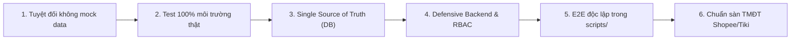
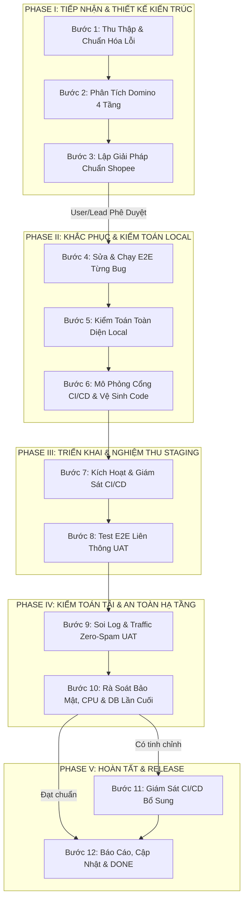

# 📘 QUY TRÌNH KỸ THUẬT XỬ LÝ BUG & KIỂM THỬ E2E (README-BUG)
> **Tài liệu Chuẩn hóa Quản trị Dự án Kỹ thuật (Technical Project Management Standard - TPM)**  
> **Áp dụng cho:** Toàn bộ chu kỳ phát triển Monorepo HuKi Platform (`web: 141 routes`, `platform: 7 microservices`, `databases: PostgreSQL, MongoDB, Redis, RabbitMQ`).

---

## 🧭 TÔN CHỈ & NGUYÊN TẮC CỐT LÕI (CORE PRINCIPLES)



1. **Tuyệt đối không mock data trên giao diện - Không làm qua loa:**
   - Sửa tận gốc rễ cơ sở dữ liệu và logic nghiệp vụ. Cấm tuyệt đối các giải pháp chắp vá (hardcoded strings, workaround tạm bợ, mock client state) nhằm che giấu lỗi bề mặt.
2. **Kiểm thử 100% trên môi trường & dữ liệu thật:**
   - Frontend chạy thật (`http://localhost:3100`), Backend Gateway thật (`http://localhost:3000`), microservices thật và cơ sở dữ liệu thật.
3. **Nguồn dữ liệu chân lý duy nhất (Single Source of Truth):**
   - Mọi số liệu thống kê (tồn kho, doanh thu, hoa hồng, trạng thái đơn, ví tiền, phí sàn) phải tính toán trực tiếp từ bảng cơ sở dữ liệu quan hệ, không tính độc lập ở Client.
4. **Bảo mật & Kiểm soát phòng thủ tại Backend (Defensive Backend):**
   - Mọi quy tắc nghiệp vụ, chống gian lận (Anti-Fraud, Self-referral, phân quyền RBAC) phải thực thi tại Backend Services. Frontend chỉ phản chiếu trạng thái để tối ưu trải nghiệm (UX).
5. **Kiểm thử E2E độc lập, giữ sạch mã nguồn chính:**
   - Toàn bộ script kiểm thử tự động lưu tại thư mục [`scripts/`](file:///e:/HuKi/scripts/) (hoặc `scripts/uat-audit/`), tuyệt đối không chèn code test tạm bợ vào `src/`.
6. **Lập tài liệu giải pháp trước khi đụng code:**
   - Luôn phân tích nguyên nhân, đánh giá hiệu ứng domino và lập kế hoạch giải pháp duy nhất chuẩn sàn TMĐT (Shopee, Tiki, Amazon) trình duyệt trước khi sửa source code.
7. **Quy tắc phân chặng nội bộ từng bước (Internal Step Sharding - Tối đa 3 bug / giai đoạn & Dừng lại):**
   - Các bước lớn (Bước 2, Bước 3, Bước 4) là hoàn toàn tách biệt, tuần tự và độc lập.
   - Khi một đợt có nhiều lỗi (> 3 bug, ví dụ đợt này có 6 bug), thì **bên trong từng bước (Bước 2, Bước 3, Bước 4)** bắt buộc phải chia làm các Giai đoạn (Stages), mỗi giai đoạn xử lý **tối đa 3 bug**:
     * **Tại Bước 2 (Tìm nguyên nhân):** Giai đoạn 1 (bóc tách 3 bug đầu) ➔ DỪNG LẠI báo cáo; Giai đoạn 2 (bóc tách 3 bug tiếp theo) ➔ DỪNG LẠI báo cáo. Phân tích xong toàn bộ mới được sang Bước 3.
     * **Tại Bước 3 (Lập giải pháp):** Giai đoạn 1 (lập giải pháp & bộ câu hỏi chọn cho 3 bug đầu) ➔ DỪNG LẠI chờ duyệt; Giai đoạn 2 (lập giải pháp cho 3 bug tiếp theo) ➔ DỪNG LẠI chờ duyệt. Duyệt xong toàn bộ mới được sang Bước 4.
     * **Tại Bước 4 (Sửa code & E2E):** Giai đoạn 1 (sửa & chạy E2E cho 3 bug đầu) ➔ DỪNG LẠI nghiệm thu; Giai đoạn 2 (sửa & chạy E2E cho 3 bug tiếp theo) ➔ DỪNG LẠI nghiệm thu. Sửa và E2E pass toàn bộ mới được sang Bước 5.
8. **Nguyên tắc bất di bất dịch: Làm xong bước này mới qua bước kia (Strictly Sequential Execution):**
   - Tuyệt đối tuân thủ trình tự tuần tự 12 bước. Không được làm nhảy cóc, không vừa phân tích vừa sửa code, không chuyển sang bước tiếp theo khi bước hiện tại chưa hoàn thành 100% tất cả các giai đoạn (stages) và chưa có sự phê duyệt/chỉ đạo rõ ràng từ Người dùng / Project Manager.
9. **Quy tắc Commit Checkpoint sau mỗi giai đoạn/bước (Mandatory Checkpoint Commit):**
   - Sau khi hoàn thành và nghiệm thu xong bất kỳ giai đoạn (Stage) nào hoặc bước (Step) nào, bắt buộc phải cập nhật đầy đủ tài liệu Markdown (`BUG.md`), chạy kiểm tra biên dịch/typecheck, và thực hiện lệnh `git commit` lưu lại checkpoint lịch sử rõ ràng (với format commit message chuẩn nghiệp vụ) trước khi báo cáo hoặc chuyển sang giai đoạn/bước tiếp theo. Tuyệt đối không để dồn nhiều giai đoạn hay bước vào một commit khổng lồ.

---

> [!IMPORTANT]
> ### 🛑 NGUYÊN TẮC BẤT DI BẤT DỊCH: LÀM XONG BƯỚC NÀY MỚI QUA BƯỚC KIA & COMMIT TỪNG CHẶNG
> - **Quy tắc tuần tự tuyệt đối:** Phải làm xong 100% bước này (bao gồm hoàn thành tất cả các giai đoạn nội bộ và nhận được phê duyệt) thì mới được chuyển sang bước kia.
> - **Cập nhật MD & Commit sau mỗi chặng:** Xong mỗi giai đoạn hoặc bước là phải cập nhật tài liệu và `git commit` checkpoint ngay lập tức.
> - **Phân tách trách nhiệm rõ ràng:**
>   * Ở **Bước 2**: Chỉ khảo sát, đọc code thực tế, tìm nguyên nhân gốc rễ và lập ma trận domino. Tuyệt đối KHÔNG sửa code, KHÔNG chạy test bừa bãi. Xong từng giai đoạn (tối đa 3 bug) phải DỪNG LẠI báo cáo & commit checkpoint MD.
>   * Ở **Bước 3**: Thiết lập phương án giải pháp chuẩn sàn Shopee, đưa ra bộ câu hỏi trắc nghiệm tương tác để Người dùng chọn, không tự ý quyết định. Duyệt xong toàn bộ mới sang Bước 4.
>   * Ở **Bước 4**: Tiến hành sửa code và chạy E2E độc lập trong thư mục `scripts/` cho từng bug. Nghiệm thu từng giai đoạn (tối đa 3 bug) ➔ DỪNG LẠI báo cáo, cập nhật MD và commit checkpoint. Nghiệm thu pass 100% toàn bộ mới sang Bước 5.

---

## 🔄 MA TRẬN 12 BƯỚC QUẢN TRỊ DỰ ÁN (PROJECT MANAGEMENT WORKFLOW)



---

### GIAI ĐOẠN I: TIẾP NHẬN & THIẾT KẾ KIẾN TRÚC

#### 📌 Bước 1: Tiếp nhận, Thu thập & Chuẩn hóa Hồ sơ Lỗi (Bug Ingestion & Triaging)
* **Mục tiêu:** Định danh chính xác lỗi, ngăn chặn hiểu nhầm yêu cầu và thu thập đủ bằng chứng kỹ thuật.
* **Điều kiện kích hoạt (Entry Criteria):** Phát hiện lỗi từ giao diện thực tế, robot Playwright quét tự động, hoặc log Terminal / Console.
* **Quy chuẩn thực thi:**
  1. Thu thập dữ liệu theo chuẩn kỹ thuật 5W1H:
     - **Who (Role):** `BUYER`, `SELLER`, `DELIVERY_STAFF` (Shipper), `PLATFORM_ADMIN`, hay `AFFILIATE`.
     - **Where (Route/Screen):** URL chính xác (ví dụ: `/seller/finance`, `/admin/escrow`, `/shipper`).
     - **What (Expected vs Actual):** Mô tả rõ ràng hành vi kỳ vọng vs hành vi lỗi thực tế.
     - **Evidence (Bằng chứng):** Ảnh chụp màn hình, video thao tác, payload Request/Response, HTTP status code (400, 403, 404, 500, 503).
  2. Ghi nhận tập trung vào tài liệu backlog [`BUG.md`](file:///e:/HuKi/BUG.md) theo mã chuẩn `BUG-XXX`.
* **Sản phẩm đầu ra (Deliverable):**Hồ sơ lỗi được chuẩn hóa và ghi nhận đầy đủ vào tài liệu backlog/sprint hiện hành của dự án (ví dụ: [BUG.md](file:///e:/HuKi/BUG.md) hoặc file .md quản lý task mới).
* **Cổng kiểm soát (Quality Gate):** Người dùng / Lead rà soát và xác nhận đúng 100% phạm vi lỗi trước khi chuyển bước.

---

> [!IMPORTANT]
> ### 🛑 QUY CHẾ PHÂN CHẶNG NỘI BỘ (TỐI ĐA 3 BUG / GIAI ĐOẠN TRONG BƯỚC 2, 3, 4)
> Các bước 2, 3, 4 là **hoàn toàn riêng biệt và tuần tự**. Khi đợt xử lý có nhiều hơn 3 lỗi (ví dụ đợt này có 6 bug), thì **trong từng bước** phải chia thành các Giai đoạn nhỏ (mỗi giai đoạn tối đa 3 bug) và **xong mỗi giai đoạn là DỪNG LẠI**:
> * **Ở Bước 2 (Tìm nguyên nhân):** Chia 2 giai đoạn (GĐ1: phân tích 3 bug đầu ➔ DỪNG LẠI báo cáo; GĐ2: phân tích 3 bug sau ➔ DỪNG LẠI báo cáo). Xong cả 6 bug mới chuyển lên Bước 3.
> * **Ở Bước 3 (Lập giải pháp & Bộ câu hỏi):** Chia 2 giai đoạn (GĐ1: lập giải pháp cho 3 bug đầu ➔ DỪNG LẠI chờ chọn/duyệt; GĐ2: lập giải pháp cho 3 bug sau ➔ DỪNG LẠI chờ chọn/duyệt). Duyệt xong toàn bộ mới chuyển lên Bước 4.
> * **Ở Bước 4 (Sửa bug & E2E):** Chia 2 giai đoạn (GĐ1: sửa & chạy E2E cho 3 bug đầu ➔ DỪNG LẠI nghiệm thu; GĐ2: sửa & chạy E2E cho 3 bug sau ➔ DỪNG LẠI nghiệm thu). Sửa xong và E2E pass cả 6 bug mới chuyển lên Bước 5.

---

#### 📌 Bước 2: Phân tích Nguyên nhân Gốc rễ & Ma trận Rủi ro Domino (Root Cause Analysis & Domino Matrix)
* **Mục tiêu:** Bóc tách tận gốc rễ nguyên nhân qua 4 tầng kiến trúc; không xử lý triệu chứng ngọn.
* **Điều kiện kích hoạt:** Bước 1 đã được nghiệm thu.
* **Quy chuẩn thực thi:**
  1. **Bóc tách 4 tầng kiến trúc (4-Tier Architectural Audit):**
     * *Tầng 1 - Database:* Schema, migrations, quan hệ Foreign Keys, Transaction locks (`FOR UPDATE`), tính nhất quán dữ liệu (ACID).
     * *Tầng 2 - Backend Services:* DTO validation, xử lý thiếu transaction (`tx`), nuốt lỗi `try/catch`, công thức tính toán tài chính/ký quỹ, lỗi consumer RabbitMQ.
     * *Tầng 3 - Gateway & Proxy:* Định tuyến route, CORS, xác thực token, đồng bộ internal headers, WebSocket / Socket.io events.
     * *Tầng 4 - Frontend Client:* State synchronization, race conditions, hydration mismatch giữa SSR và Client, thiếu cache invalidation.
  2. **Lập Ma trận Rủi ro Domino (Cross-Impact Assessment):**
     * Đánh giá tác động dây chuyền: Sửa đổi tại một service ảnh hưởng thế nào đến các luồng khác (ví dụ: sửa công thức Escrow ảnh hưởng đến Ví người bán, Lệnh rút tiền, Báo cáo thuế, Đối soát Shipper và Hoa hồng Affiliate).
* **Sản phẩm đầu ra (Deliverable):**Báo cáo phân tích nguyên nhân gốc rễ và ma trận rủi ro trong tài liệu kỹ thuật.
* **Cổng kiểm soát (Quality Gate):** Xác định chính xác 100% dòng mã / truy vấn lỗi và các rủi ro lan truyền.

---

#### 📌 Bước 3: Lập Phương án Kiến trúc Chuẩn Shopee & Bộ Câu Hỏi Tương Tác Phê Duyệt Giải Pháp (Interactive Architectural Solution & Approval Gate)
* **Mục tiêu:** Thiết lập phương án kỹ thuật chuẩn mực theo mô hình sàn TMĐT (Shopee, Tiki, Amazon); người dùng trực tiếp bấm chọn và quyết định hướng đi qua bộ câu hỏi tương tác.
* **Điều kiện kích hoạt:** Bước 2 đã hoàn thành (đã bóc tách rõ nguyên nhân gốc rễ và ma trận domino).
* **Quy chuẩn thực thi:**
  1. **Tôn chỉ thực hiện:** Làm chậm lại, kỹ lưỡng, giải quyết triệt để tận gốc, tuyệt đối không làm qua loa như cho có.
  2. **Bộ câu hỏi tương tác & Phỏng vấn nghiệp vụ (Interactive Decision Form):**
     - **Tuyệt đối không tự ý quyết định ngầm:** Khi có các hướng tiếp cận kiến trúc, phân chia luồng tiền, hoặc ranh giới phân hệ, Agent bắt buộc phải xuất bộ câu hỏi trắc nghiệm tương tác để Người dùng/Product Owner bấm chọn phương án mong muốn.
     - **Chủ động làm rõ nghiệp vụ liên quan:** Nếu có bất kỳ mắt xích nghiệp vụ nào chưa rõ ràng (ví dụ: cách hiển thị thuế, cơ chế bồi hoàn hoàn trả, xử lý hoa hồng khi hủy đơn con, chính sách phí sàn đối với đơn combo), phải đặt câu hỏi làm rõ trước.
     - **Ưu tiên phương án Chuẩn Shopee lên hàng đầu:** Các lựa chọn phải tham chiếu trực tiếp từ cơ chế vận hành của Shopee. Lựa chọn tối ưu, chuẩn nghiệp vụ sàn nhất luôn được đặt ở vị trí số 1 với tiền tố: `(Khuyến nghị) [Chuẩn Shopee]: ...` kèm theo phân tích rõ ưu/nhược điểm kỹ thuật và tác động dòng tiền.
  3. **Thiết lập Tiêu chuẩn Nghiệm thu (Acceptance Criteria - AC):**
     - Viết theo chuẩn BDD / Gherkin (`Given ... When ... Then`).
     - Đặt ngưỡng định lượng: Thời gian phản hồi < 500ms, 0 lỗi console, HTTP 200, DB khớp số liệu 100%.
* **Sản phẩm đầu ra (Deliverable):**Kế hoạch giải pháp chi tiết đính kèm bộ câu hỏi lựa chọn và tiêu chuẩn nghiệm thu rõ ràng.
* **Cổng kiểm soát (Quality Gate):** **DỪNG LẠI (HALT)** — Người dùng bấm chọn phương án và chính thức bấm xác nhận phê duyệt giải pháp thì mới được phép sang Bước 4 (chạm vào source code).

---

### GIAI ĐOẠN II: KHẮC PHỤC & KIỂM TOÁN NỘI BỘ (LOCAL)

#### 📌 Bước 4: Sửa Tận Gốc & Chạy E2E Ngay Từng Bug (Fix & Immediate Isolated E2E per Bug)
* **Mục tiêu:** Hiện thực hóa giải pháp và chứng minh tính đúng đắn ngay lập tức trên từng con bug.
* **Điều kiện kích hoạt:** Kế hoạch Bước 3 đã được phê duyệt; đang đứng trên nhánh git chuẩn (ví dụ: `fix-bug-local`).
* **Quy chuẩn thực thi:**
  1. Tiến hành sửa code nghiệp vụ tại Backend / Frontend và tạo migration DB chuẩn hóa (nếu có).
  2. **Nguyên tắc vàng:** *Sửa xong bug nào thì viết và chạy script kiểm thử E2E độc lập cho đúng bug đó ngay lập tức*.
  3. **Quy tắc thư mục kiểm thử:**
     - Toàn bộ script kiểm thử bắt buộc lưu trong [`scripts/`](file:///e:/HuKi/scripts/) (định dạng `scripts/test_e2e_bugXXX_<mota>.js`).
     - **Tuyệt đối không chèn mã test tạm bợ, mock data vào thư mục `src/`** để giữ sạch source code.
  4. Thực hiện kiểm thử trên môi trường thật: Frontend (`:3100`), Backend (`:3000`), Database PostgreSQL thật.
* **Sản phẩm đầu ra (Deliverable):**
  - Mã nguồn đã được sửa tận gốc.
  - Script test E2E độc lập chạy thành công (Exit code 0, 100% assertions PASS).
* **Cổng kiểm soát (Quality Gate):** Toàn bộ kịch bản của từng bug chạy thực tế không lỗi, đáp ứng 100% Acceptance Criteria của Bước 3.

---

#### 📌 Bước 5: Kiểm Toán Toàn Diện Local: Dịch Vụ, Lỗi Ngầm, Spam & Bảo Mật (Local Deep Audit Gate)
* **Mục tiêu:** Rà soát toàn diện hệ sinh thái Local, ngăn chặn rò rỉ bảo mật và tắc nghẽn tài nguyên trước khi đẩy code.
* **Điều kiện kích hoạt:** Tất cả các bug trong đợt đã được sửa và pass E2E riêng lẻ ở Bước 4.
* **Quy chuẩn thực thi (5 Trục Kiểm toán Chuyên sâu):**
  1. **Services & Frontend Health:** 7 microservices và Web Client chạy ổn định, không crash tiến trình, 0 unhandled promise rejections.
  2. **Quét lỗi chạy ngầm & Bão request (Zero-Spam):**
     - Rà soát toàn bộ `useEffect` trong `web/`: Loại bỏ các dependency array thiếu hoặc sai gây re-render vô tận.
     - Loại bỏ hoàn toàn polling dày đặc (`setInterval` 1s-2s gọi API nền như `/cart`, `/broadcast-notifications`). Chuyển sang WebSocket/SSE hoặc áp dụng Exponential Backoff + Debounce.
  3. **Kiểm tra Logs, Problems & Lint:** 0 TypeScript compile errors, 0 ESLint errors nghiêm trọng, sạch cảnh báo cú pháp.
  4. **Kiểm toán Bảo mật & Gitflow Secrets (Security Audit):**
     - Quét Git status/diff: Tuyệt đối không để lộ key, secrets, token, value `.env` vào commit.
     - Chống các lỗ hổng Injection, IDOR, phân quyền sai (RBAC), privilege escalation.
  5. **Hiệu năng & Tài nguyên:** Không có background worker / hot retry loop làm CPU tăng vọt 100%; mọi Prisma connection đều có timeout và giải phóng kết nối đúng cách.
* **Sản phẩm đầu ra (Deliverable):**Báo cáo kiểm toán nội bộ sạch (0 errors, 0 leak, 0 spam).
* **Cổng kiểm soát (Quality Gate):** Môi trường Local vận hành mượt mà, yên tĩnh, không spam console/terminal.

---

#### 📌 Bước 6: Bộ Cổng Kiểm Soát Chất Lượng Mô Phỏng CI/CD & Vệ Sinh Mã Nguồn (Local CI/CD Quality Gates & Clean Code)
* **Mục tiêu:** Mô phỏng chính xác 100% các tiêu chuẩn kiểm thử của GitHub Actions CI/CD (`.github/workflows/ci.yml`) tại môi trường nội bộ trước khi tạo Pull Request hoặc Push code lên remote; đảm bảo khi code đẩy lên CI luôn đạt trạng thái XANH TUYỆT ĐỐI (100% PASS), loại trừ triệt để tình trạng lệch contract, lệch unit test hay gãy build.
* **Điều kiện kích hoạt:** Bước 5 đã hoàn tất không còn lỗi tồn đọng.
* **Quy chuẩn thực thi (4 Cổng Kiểm Soát Nghiêm Ngặt - 4 Local CI/CD Gates):**
  1. **Gate 1 - Vệ sinh Git & Rà soát Bí mật (Git Hygiene & Secrets Scan):**
     ```bash
     git status
     git diff --check
     ```
     - Đảm bảo Working tree sạch sẽ (`working tree clean`).
     - Tuyệt đối không còn file rác `.tmp`, logs vương vãi, khoảng trắng lỗi cú pháp hoặc thông tin nhạy cảm / token / secret bị lộ.
  2. **Gate 2 - Toàn vẹn Lược đồ & Prisma Schema (Schema & Migration Integrity):**
     ```bash
     # Kiểm tra format và tính hợp lệ của toàn bộ schema Prisma đa dịch vụ
     powershell -Command "Get-ChildItem -Path platform/apps/*/prisma/schema.prisma | ForEach-Object { npx prisma validate --schema $_.FullName }"
     ```
     - 100% file `schema.prisma` phải hợp lệ cú pháp, không có xung đột enum hay quan hệ quan hệ model.
  3. **Gate 3 - Bộ Kiểm Thử Đơn Vị & Khế Ước Dịch Vụ Backend (Backend Build & Contract Test Suite):**
     ```bash
     # Biên dịch shared và các service liên quan
     npm --prefix platform run build:shared
     npm --prefix platform run build:commerce

     # Chạy toàn bộ Unit & Contract Tests của các service có thay đổi mã nguồn
     npm --prefix platform test -- --runInBand --forceExit
     # Hoặc chỉ định rõ các file spec của service vừa sửa (ví dụ: reviews.service.spec, banners.service.spec, user.controller.spec)
     ```
     - **Tiêu chuẩn vàng:** 100% Unit Tests & Contract Tests phải đạt kết quả PASS (mã thoát 0).
     - **Nguyên tắc cập nhật contract:** Nếu việc sửa bug dẫn đến thay đổi DTO response (ví dụ: thêm trường trả về, chuyển endpoint sang idempotent, đổi chữ ký hàm), BẮT BUỘC phải cập nhật lại assertions trong các file `.spec.ts` tương ứng và xác nhận `PASS` 100% ở bước này trước khi commit. Tuyệt đối không để xảy ra lệch signature giữa code thực tế và unit test.
  4. **Gate 4 - Kiểm Tra Kiểu Dữ Liệu & Bản Dựng Frontend (Frontend Typecheck, Lint & Production Build):**
     ```bash
     npm --prefix web run typecheck
     npm --prefix web run build
     ```
     - **Tiêu chuẩn:** `web run typecheck` đạt 0 TypeScript errors.
     - `web run build` phải biên dịch thành công 100% các trang tĩnh/SSR Next.js, không phát sinh lỗi hydration mismatch, 0 lỗi JSX parser.
* **Sản phẩm đầu ra (Deliverable):**
  - Toàn bộ 4 Cổng kiểm soát cục bộ đạt mã thoát 0 (Exit code 0).
  - Bản commit sạch sẽ, đầy đủ commit message nghiệp vụ, đồng bộ khế ước kiểm thử.
* **Cổng kiểm soát (Quality Gate):** **BLOCK NẾU BẤT KỲ CỔNG NÀO BỊ FAIL** — Chỉ khi cả 4 Gate đều vượt qua (100% pass) thì mới được phép merge vào `develop` và kích hoạt Bước 7 (CI/CD Pipeline).

---

### GIAI ĐOẠN III: TRIỂN KHAI & NGHIỆM THU STAGING

#### 📌 Bước 7: Kích Hoạt & Theo Dõi Tiến Trình CI/CD Đến Khi Hoàn Tất (CI/CD Pipeline Tracking)
* **Mục tiêu:** Đưa bản vá lên máy chủ UAT Staging một cách tự động và an toàn.
* **Điều kiện kích hoạt:** Bước 6 đã pass toàn bộ.
* **Quy chuẩn thực thi:**
  1. Push nhánh lên remote hoặc tạo Pull Request merge vào `develop`.
  2. Theo dõi trực tiếp tiến trình GitHub Actions (`.github/workflows/deploy-staging.yml`):
     - Quá trình build Docker images của các microservices và web.
     - Quá trình deploy SSH lên VPS UAT.
     - Quá trình tự động chạy database migration (`npx prisma db push`).
     - Quá trình restart cụm container.
  3. Bám sát tiến trình cho đến khi Pipeline kết thúc thành công (báo xanh).
* **Sản phẩm đầu ra (Deliverable):**Pipeline CI/CD hoàn thành với trạng thái `SUCCESS`.
* **Cổng kiểm soát (Quality Gate):** Toàn bộ container trên máy chủ UAT khởi động lại thành công và ở trạng thái `Up (healthy)`.

---

#### 📌 Bước 8: Chạy Kiểm Thử E2E Lại Toàn Bộ Các Bug Trên UAT Thật (Live Staging Verification)
* **Mục tiêu:** Xác nhận các bug đã thực sự được giải quyết trên môi trường triển khai thực tế.
* **Điều kiện kích hoạt:** Bước 7 đã deploy hoàn tất lên server UAT.
* **Quy chuẩn thực thi:**
  1. Sử dụng các script E2E độc lập trong [`scripts/`](file:///e:/HuKi/scripts/) cấu hình `BASE_URL=https://huki-uat.duckdns.org/api/v1`.
  2. Thực thi lại toàn bộ kịch bản kiểm thử tương ứng với các bug từ Bước 1:
     - Kịch bản Flash Sale của Seller.
     - Kịch bản Duyệt Affiliate & Đồng bộ Realtime.
     - Kịch bản Shipper nhận & chuyển trạng thái giao hàng.
     - Kịch bản Đối soát Escrow, trừ phí sàn 5% và trích hoa hồng CTV.
     - Kịch bản Thống kê số liệu sổ cái giữa 3 màn hình.
* **Sản phẩm đầu ra (Deliverable):**Nhật ký chạy E2E trên UAT với 100% test cases đạt kết quả PASS.
* **Cổng kiểm soát (Quality Gate):** Không còn bất kỳ assertion nào bị fail trên môi trường UAT thật.

---

### GIAI ĐOẠN IV: KIỂM TOÁN TẢI & AN TOÀN HẠ TẦNG THỰC TẾ

#### 📌 Bước 9: Kiểm Toán Môi Trường UAT Thực Tế: Logs & Traffic (Live Staging Audit)
* **Mục tiêu:** Đảm bảo hệ thống khi hoạt động thực tế trên máy chủ không bị lỗi ngầm hoặc gây nghẽn băng thông.
* **Điều kiện kích hoạt:** Bước 8 đã pass E2E live.
* **Quy chuẩn thực thi:**
  1. **Kiểm toán Traffic Trình duyệt (Browser Zero-Spam Verification):**
     - Mở DevTools Network Tab khi người dùng ở trạng thái nghỉ (idle) trên các trang trọng yếu (`/`, `/seller/finance`, `/admin/escrow`, `/account/affiliate/dashboard`).
     - **Tiêu chuẩn:** Tuyệt đối không có request nào bị bắn lặp liên tục mỗi giây; không phát sinh mã lỗi `HTTP 429 Too Many Requests`.
  2. **Soi chiếu Nhật ký Container VPS (Server Container Logs):**
     - Chạy `docker logs --tail=200 <container>` trên các dịch vụ: `api-gateway`, `commerce-service`, `shipping-service`, `identity-service`, `web`.
     - **Tiêu chuẩn:** Không có ngoại lệ `500 Internal Server Error`, không có `ECONNREFUSED` lặp lại, không có unhandled promise rejections.
* **Sản phẩm đầu ra (Deliverable):**Bằng chứng logs sạch từ DevTools Network và Docker Container Logs.
* **Cổng kiểm soát (Quality Gate):** Hệ thống ở trạng thái tĩnh không tiêu tốn request thừa, logs sạch bóng lỗi.

---

#### 📌 Bước 10: Rà Soát Bảo Mật, Hiệu Năng & An Toàn Cơ Sở Dữ Liệu Lần Cuối (Final Security & DB Gate)
* **Mục tiêu:** Đảm bảo hệ thống chịu tải an toàn, cơ sở dữ liệu không bị nghẽn khóa và cấu hình bảo mật vững chắc.
* **Điều kiện kích hoạt:** Bước 9 đã đạt chuẩn.
* **Quy chuẩn thực thi:**
  1. **Giám sát CPU & RAM thực tế:**
     - Chạy lệnh `docker stats --no-stream` trên VPS.
     - **Tiêu chuẩn:** Toàn bộ cụm container ở trạng thái idle tiêu hao CPU < 15-20%, RAM không tăng tịnh tiến (không memory leak).
  2. **Kiểm tra Hàng đợi Message Broker:**
     - RabbitMQ: Hàng đợi `huki.events` có lag count = 0, Dead Letter Queue (`*.dlq`) không bị tồn đọng thông điệp lỗi.
  3. **Kiểm toán Cơ sở Dữ liệu (Database Health):**
     - Đảm bảo connection pool của PostgreSQL ổn định, không bị connection leak, không có truy vấn chạy ngầm bị treo khóa (`idle in transaction`).
* **Sản phẩm đầu ra (Deliverable):**Bản chụp thông số tài nguyên hệ thống (`docker stats`, RabbitMQ status, DB connection metrics).
* **Cổng kiểm soát (Quality Gate):** Tất cả chỉ số tài nguyên nằm trong ngưỡng an toàn tuyệt đối.

---

### GIAI ĐOẠN V: HOÀN TẤT & RELEASE

#### 📌 Bước 11: Theo Dõi CI/CD Bổ Sung Nếu Có Chỉnh Sửa Phát Sinh (Iterative CI/CD Tracking)
* **Mục tiêu:** Kiểm soát và xử lý các tinh chỉnh nhỏ phát sinh trong quá trình nghiệm thu một cách chuẩn quy trình.
* **Điều kiện kích hoạt:** Phát hiện các điểm cần tối ưu hóa thêm ở Bước 9 hoặc Bước 10.
* **Quy chuẩn thực thi:**
  - Nếu có bất kỳ điều chỉnh code/style nhỏ nào: Tiến hành commit, push và tiếp tục theo dõi pipeline CI/CD đến khi deploy hoàn tất, lặp lại các kiểm tra trọng yếu.
  - Nếu hệ thống đã hoàn hảo từ Bước 10: Tự động ghi nhận thông qua để tiến thẳng sang Bước 12.
* **Sản phẩm đầu ra (Deliverable):**Lịch sử commit và pipeline deploy sạch sẽ, hoàn chỉnh.
* **Cổng kiểm soát (Quality Gate):** Mọi thay đổi phát sinh đều được kiểm chứng đầy đủ.

---

#### 📌 Bước 12: Nghiệm Thu Tổng Kết, Báo Cáo Tiến Trình & Ký Duyệt DONE (Final Sign-off & Closure)
* **Mục tiêu:** Bàn giao chính thức, cập nhật toàn bộ tài liệu dự án và đóng task.
* **Điều kiện kích hoạt:** Toàn bộ 11 bước trước đó đã hoàn tất và được xác thực 100%.
* **Quy chuẩn thực thi:**
  1. Cập nhật trạng thái chi tiết trong [`BUG.md`](file:///e:/HuKi/BUG.md): Đánh dấu `[ĐÃ XỬ LÝ & NGHIỆM THU]` kèm theo link commit, PR và bằng chứng test.
  2. Cập nhật Báo cáo Kiểm toán Tổng hợp [`task/uat-audit/MASTER-AUDIT-REPORT.md`](file:///e:/HuKi/task/uat-audit/MASTER-AUDIT-REPORT.md).
  3. Kiểm tra Checklist sẵn sàng Release:
     - [x] **Zero Fallback Keys:** Không còn chuỗi fallback giả lập.
     - [x] **Zero Cross-DB SQL:** 100% tuân thủ ranh giới dịch vụ qua API / Domain Events.
     - [x] **Zero Request Spamming:** Không còn vòng lặp re-render hoặc polling dày đặc.
     - [x] **Zero CPU Spikes:** Hạ tầng vận hành êm ái, CPU idle thấp, RAM ổn định.
     - [x] **Full E2E Live Passed:** Toàn bộ nghiệp vụ kiểm thử thực tế đạt 100% pass.
  4. Tạo Pull Request chính thức hợp nhất nhánh `fix-bug-local` vào nhánh chính (`develop` / `main`).
* **Sản phẩm đầu ra (Deliverable):**
  - Báo cáo tổng kết nghiệm thu hoàn chỉnh.
  - Pull Request sẵn sàng Release.
* **Cổng kiểm soát (Quality Gate):** Ký duyệt chính thức đóng task: **DONE RELEASE**.

---

## 📂 BẢN ĐỒ TÀI LIỆU & THƯ MỤC LIÊN QUAN

| Tập tin / Thư mục | Mục đích sử dụng |
| :--- | :--- |
| [`readme-bug.md`](file:///e:/HuKi/readme-bug.md) | **Tài liệu này** — Quy trình quản trị dự án chuẩn hóa 12 bước từ Bug Local đến UAT Done |
| [BUG.md](file:///e:/HuKi/BUG.md) (hoặc task file mới) | Báo cáo rà soát lỗi chi tiết & danh mục backlog nhiệm vụ đang thực thi |
| [`SOLUTION.md`](file:///e:/HuKi/SOLUTION.md) | Thiết kế kiến trúc giải pháp chuẩn Shopee cho các phân hệ cốt lõi |
| [`task/solutions-and-e2e-roadmap.md`](file:///e:/HuKi/task/solutions-and-e2e-roadmap.md) | Lộ trình và kịch bản chi tiết cho các bug giao diện & backend |
| [`task/uat-audit/MASTER-AUDIT-REPORT.md`](file:///e:/HuKi/task/uat-audit/MASTER-AUDIT-REPORT.md) | Báo cáo kiểm toán tổng hợp trên môi trường UAT Staging |
| [`scripts/`](file:///e:/HuKi/scripts/) | Thư mục chứa toàn bộ script kiểm thử tự động độc lập |
| [`scripts/uat-audit/`](file:///e:/HuKi/scripts/uat-audit/) | Thư mục script kiểm toán chuyên biệt cho UAT |
