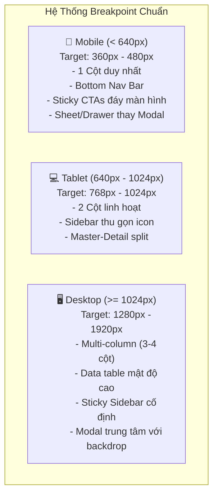

# BỘ TÀI LIỆU TASK & TIÊU CHUẨN UI/UX TOÀN DIỆN NỀN TẢNG HUKI (E-COMMERCE PRODUCTION)

> **Mục tiêu:** Chuẩn hóa toàn bộ trải nghiệm người dùng (UX) và giao diện (UI) cho 5 phân hệ (**Guest, Buyer/User, Seller, Shipper, Admin**), xóa bỏ triệt để cảm giác "AI-generated" (phần tử quá to, viền sặc sỡ, icon/emoji spam, thiếu mật độ thông tin), đạt độ hoàn thiện cao như các nền tảng thương mại điện tử hàng đầu (Shopee, Apple, Linear, Tiki).

---

## 1. Bản Tuyên Ngôn Thiết Kế "Anti-AI" (The Human-Crafted Design Manifesto)

### 1.1. Hiện trạng: Tại sao UI hiện tại lại "nhìn như AI làm"?
1. **Kích thước phần tử quá to (Oversized & Low Density):**
   - Các nút bấm, card, tiêu đề, padding dùng tỷ lệ quá lớn (`text-lg`, `text-xl`, `p-6`, `p-8`, `h-14`), khiến màn hình chỉ hiển thị được 2-3 phần tử là hết chỗ, buộc người dùng cuộn mỏi tay.
   - Khoảng trống thừa thãi (excessive whitespace) nhưng lại không có dữ liệu thực tế.
2. **Lạm dụng Emoji & Icon trang trí lòe loẹt:**
   - Đặt icon và emoji khắp mọi nơi: `📢`, `🛡️`, `🏪`, `🛵`, `👤`, `⚠️`, `✨`, `🔥`, `🚀`.
   - Các thông báo hệ thống bình thường đều bị gán tam giác vàng cảnh báo nguy hiểm (`⚠️ warning`), tạo cảm giác hoảng loạn và rẻ tiền.
3. **Viền và đổ bóng màu mè (Rainbow Borders & Loud Shadows):**
   - Viền thẻ dùng màu xanh neon, tím, cam sặc sỡ (`border-emerald-300`, `border-purple-400`, `ring-4`).
   - Đổ bóng đậm gắt (`shadow-xl`, `shadow-2xl` trên các card phẳng), gradient nền lòe loẹt làm mất tập trung vào sách và nội dung bán hàng.
4. **Xếp chồng quá nhiều Badge rác (Badge Clutter):**
   - Một dòng tiêu đề gắn tới 3-4 nhãn: `[Quản trị viên] [ƯU TIÊN] [KHẨN CẤP] [HOT]`.
   - Badge kích thước to, màu nền quá chói, làm loãng thông tin quan trọng.
5. **Mã số kỹ thuật lộ liễu:**
   - Để lộ chuỗi hash hoặc timestamp ngẫu nhiên (`#1792342547426`) ngay trên giao diện người dùng thay vì mã đơn hàng/mã sách chuẩn SEO ngắn gọn.

### 1.2. Bộ 5 Nguyên Tắc Vàng "Human-Crafted"
| Tiêu chí | Kiểu cũ (AI-generated / Cluttered) | Chuẩn mới (Human-Crafted / High-Density) |
| :--- | :--- | :--- |
| **Mật độ thông tin** | Thưa thớt, card to khổng lồ, cuộn liên tục | Gọn gàng, tinh tế, tận dụng tối đa khung nhìn (`text-xs`, `text-[13px]`, `px-3 py-1.5`) |
| **Iconography** | Emoji màu mè khắp các tiêu đề | Icon đơn sắc tinh giản (Material Symbols 16px - 18px), dùng đúng chức năng điều hướng |
| **Đường viền & Phân cách** | Viền màu dày (`border-2 border-emerald-400`) | Viền mảnh tối giản 1px (`border-slate-200 dark:border-zinc-800`), hairline dividers |
| **Màu sắc & Trạng thái** | Nền rực rỡ, gradient tím/xanh | Bảng màu trung tính làm nền, điểm nhấn xanh ngọc lục bảo (`#003B2B` / `#00875A`) của HuKi |
| **Badge & Metadata** | Badge to đùng dồn dập | Dòng phụ tinh tế: `Ban Quản Trị · 11 ngày trước`, chấm tròn nhỏ phân biệt trạng thái |

---

## 2. Tiêu Chuẩn Responsive Cho Toàn Bộ 5 Phân Hệ

---

## 3. Cấu Trúc Thư Mục & Bản Đồ Tài Liệu Task

Bộ tài liệu được chia tách chi tiết thành 7 file chuyên biệt trong `task/ui-ux/`, bao phủ **100% toàn bộ 141 URL giao diện thực tế** trong mã nguồn:

| Phân hệ | Số lượng URL thực tế | Tỷ lệ bao phủ | File đặc tả chuyên sâu |
| :--- | :---: | :---: | :--- |
| **Guest / Public** | **22 URLs** | **100%** | [`02-GUEST-PUBLIC-EXPERIENCE.md`](file:///e:/HuKi/task/ui-ux/02-GUEST-PUBLIC-EXPERIENCE.md) |
| **Buyer / User** | **30 URLs** | **100%** | [`03-BUYER-EXPERIENCE.md`](file:///e:/HuKi/task/ui-ux/03-BUYER-EXPERIENCE.md) |
| **Seller** | **44 URLs** | **100%** | [`04-SELLER-PORTAL.md`](file:///e:/HuKi/task/ui-ux/04-SELLER-PORTAL.md) |
| **Shipper** | **10 URLs** | **100%** | [`05-SHIPPER-PORTAL.md`](file:///e:/HuKi/task/ui-ux/05-SHIPPER-PORTAL.md) |
| **Admin** | **35 URLs** | **100%** | [`06-ADMIN-CONTROL-CENTER.md`](file:///e:/HuKi/task/ui-ux/06-ADMIN-CONTROL-CENTER.md) |
| **TỔNG TOÀN SÀN** | **141 URLs** | **100.0%** | 👉 [`07-RESPONSIVE-CHECKLIST-AUDIT-MATRIX.md`](file:///e:/HuKi/task/ui-ux/07-RESPONSIVE-CHECKLIST-AUDIT-MATRIX.md) |

Chi tiết nội dung các tài liệu:
1. [`01-DESIGN-SYSTEM-ANTI-AI-GUIDELINES.md`](file:///e:/HuKi/task/ui-ux/01-DESIGN-SYSTEM-ANTI-AI-GUIDELINES.md)
   * Hệ thống Design Tokens: Typography scale rút gọn, bảng màu tinh tế, kích thước nút/input chuẩn compact, quy chuẩn icon và badge.
2. [`02-GUEST-PUBLIC-EXPERIENCE.md`](file:///e:/HuKi/task/ui-ux/02-GUEST-PUBLIC-EXPERIENCE.md)
   * 22 URL khách vãng lai: Trang chủ (`/`), Khám phá sách (`/books`), Chi tiết sách (`/book/[id]`), Đọc thử (`/book/[id]/preview`), Cửa hàng (`/stores`, `/shop/[id]`), Đăng nhập/Đăng ký (`/auth/*`), Khuyến mãi & Chính sách.
3. [`03-BUYER-EXPERIENCE.md`](file:///e:/HuKi/task/ui-ux/03-BUYER-EXPERIENCE.md)
   * 30 URL người mua: Giỏ hàng (`/cart`), Thanh toán (`/checkout`), Đơn mua & Tra cứu lộ trình (`/orders/*`), Đánh giá (`/orders/[id]/review`), Yêu cầu hoàn tiền RMA (`/orders/[id]/return`), Tủ sách số (`/library`), Đọc sách DRM WebReader (`/reader`), Sách nói (`/audiobooks`), Hồ sơ cá nhân (`/profile/*`), Tiếp thị liên kết (`/account/affiliate/*`).
4. [`04-SELLER-PORTAL.md`](file:///e:/HuKi/task/ui-ux/04-SELLER-PORTAL.md)
   * 44 URL Kênh Người Bán: Dashboard KPI (`/seller/dashboard`), Quản lý sản phẩm (`/seller/products/*`), Tồn kho (`/seller/inventory`), Xử lý đơn hàng (`/seller/orders/*`), Xử lý trả hàng/RMA (`/seller/returns/*`), Khuyến mãi shop (`/seller/promotions/*`), Ví doanh thu & Escrow (`/seller/wallet`, `/seller/finance`), Chăm sóc khách hàng & Chat.
5. [`05-SHIPPER-PORTAL.md`](file:///e:/HuKi/task/ui-ux/05-SHIPPER-PORTAL.md)
   * 10 URL Cổng Bưu Tá: Đăng nhập nhanh (`/shipper/login`), Nhận đơn quanh đây (`/shipper/available-orders`), Hành trình giao hàng (`/shipper/active-deliveries`), Chụp ảnh xác thực ký nhận (POD), Thu tiền COD & Nộp tiền về ví (`/shipper/remit-cod`, `/shipper/wallet`), Lấy hàng hoàn trả (`/shipper/returns`).
6. [`06-ADMIN-CONTROL-CENTER.md`](file:///e:/HuKi/task/ui-ux/06-ADMIN-CONTROL-CENTER.md)
   * 35 URL Quản Trị Viên: Tổng quan hệ thống (`/admin/dashboard`), Duyệt sách & bản quyền (`/admin/book-moderation`), Kho khóa mã hóa DRM Vault (`/admin/drm-vault`), Trọng tài tranh chấp & khiếu nại (`/admin/disputes`), Quản trị dòng tiền Escrow & Tài chính (`/admin/escrow`, `/admin/finance`), Quản lý tài khoản & phân quyền (`/admin/users`, `/admin/shippers`, `/admin/publishers`), Cấu hình & Bảo trì (`/admin/maintenance`).
7. [`07-RESPONSIVE-CHECKLIST-AUDIT-MATRIX.md`](file:///e:/HuKi/task/ui-ux/07-RESPONSIVE-CHECKLIST-AUDIT-MATRIX.md)
   * Bảng ma trận 141 URL: Kiểm tra từng URL trên Mobile, Tablet, Desktop, Tiêu chí loại bỏ chất AI, Trạng thái kiểm định và Tiêu chuẩn nghiệm thu (Acceptance Criteria).

